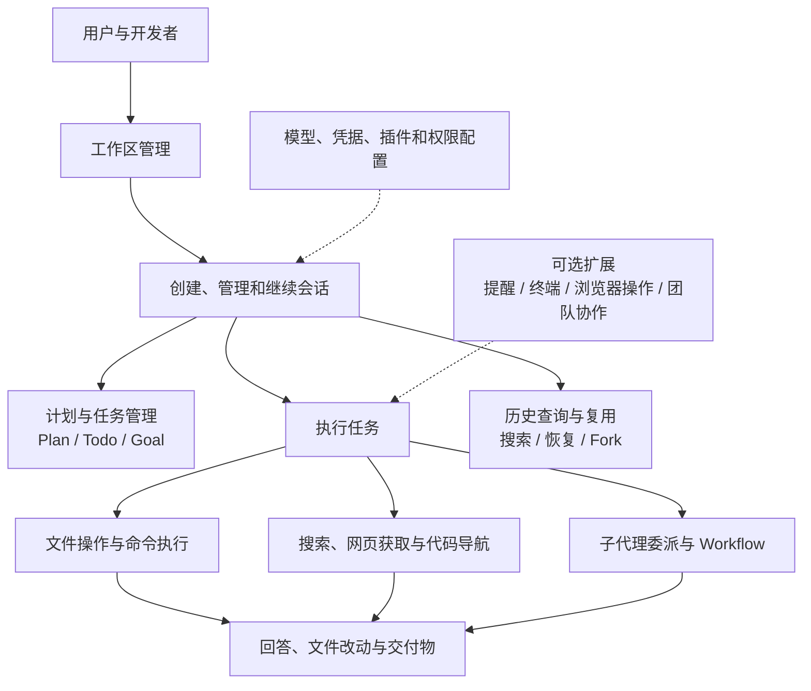
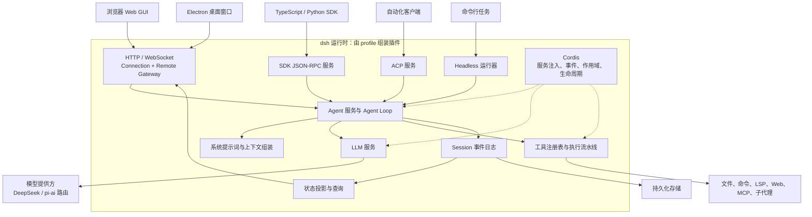
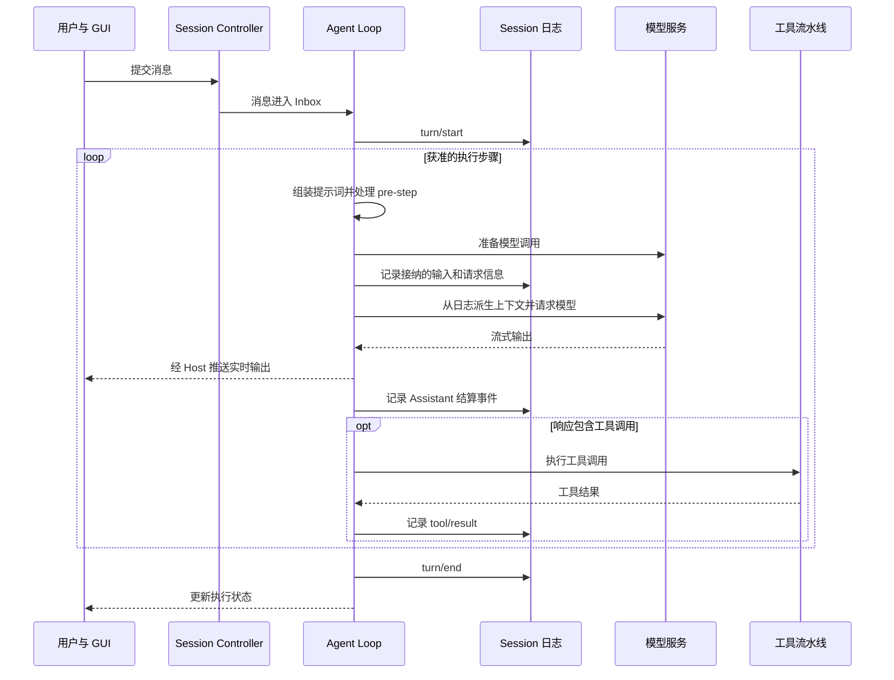
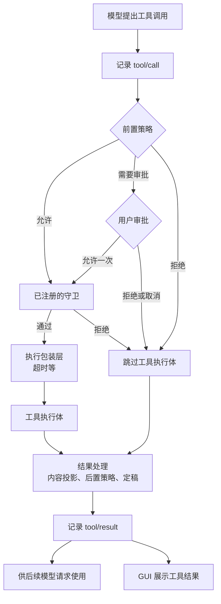
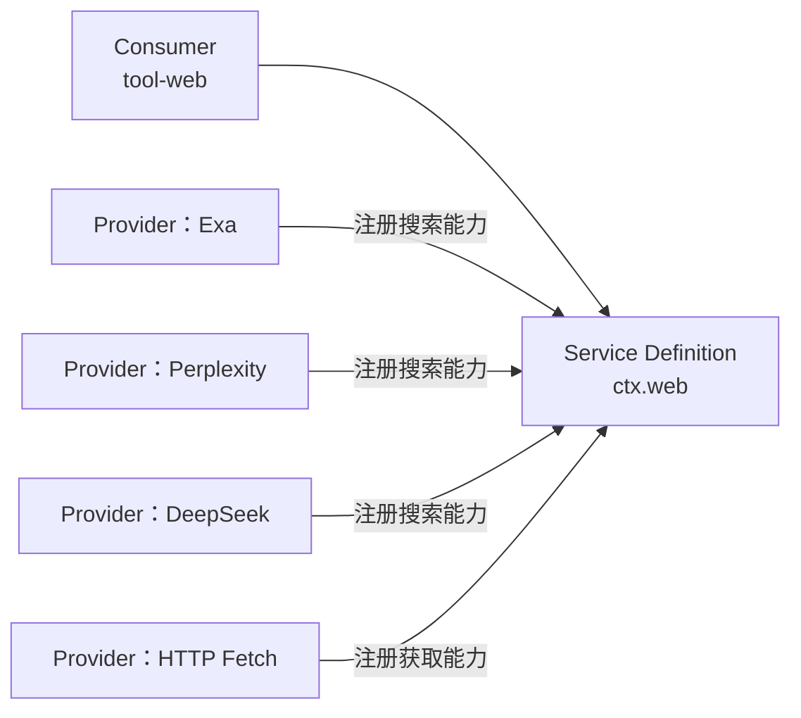
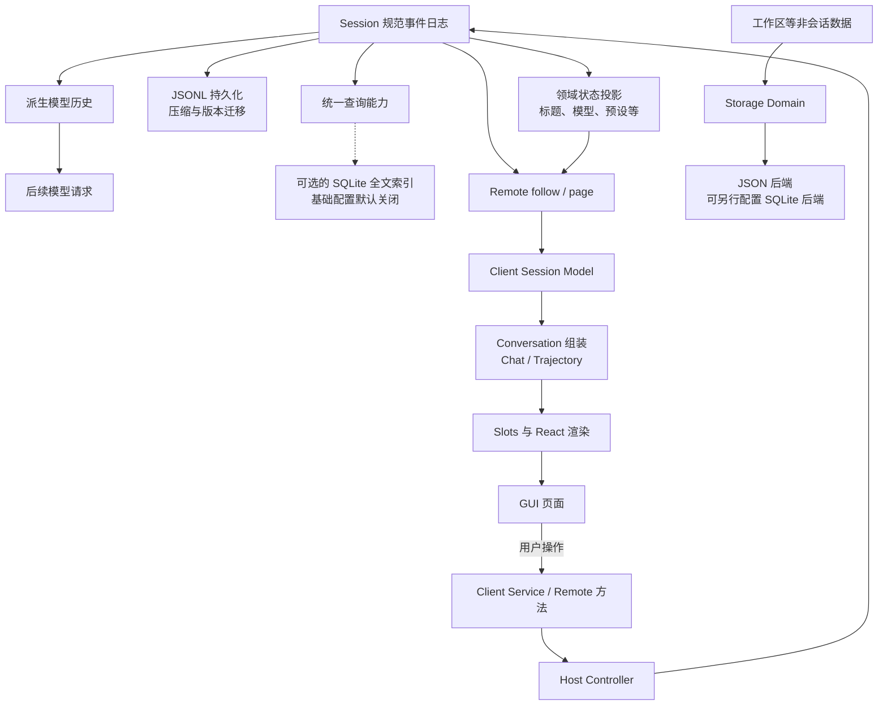
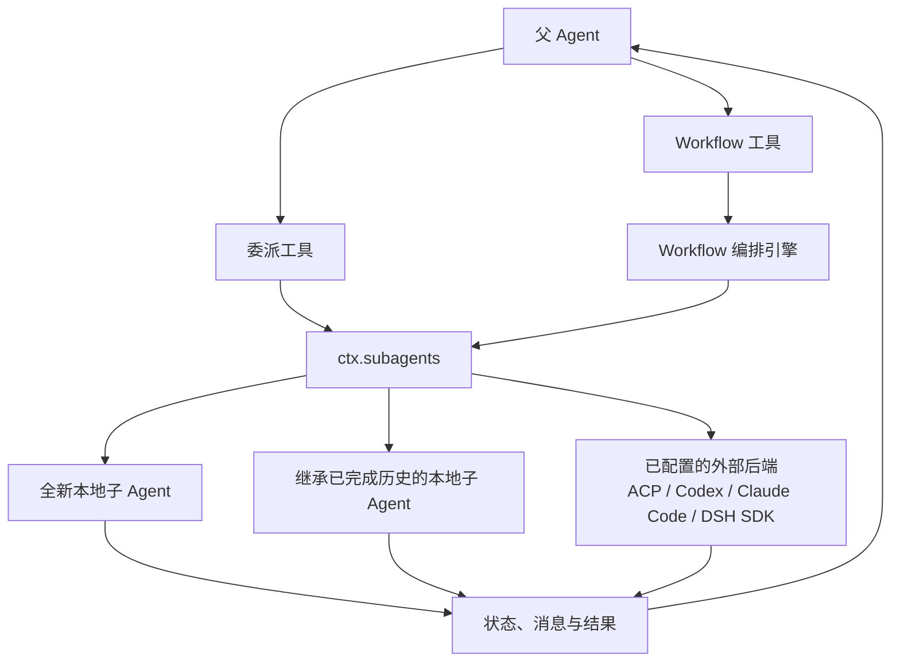

# DeepSeek Harness 技术与业务架构分析

DeepSeek Harness 使用 Cordis 插件组装 Agent 运行环境，由 Agent 循环调用模型与工具，通过会话事件日志支撑历史、恢复、查询和 GUI 展示。本文覆盖业务能力、应用组合、执行过程、前后端通信、协作编排，以及本机数据持久化位置。

分析日期：2026 年 10 月 15 日。源码版本：`0.2.1-alpha.2`，提交：`d743267388`。项目目录：`E:\CodeRepository\VibeCoding\Agent封装Claude\deepseek-harness`。

本文中的简化 Mermaid 图根据现行文档整理；仓库原图及其提案、归档状态列于文末。业务视图是依据现有功能归纳的阅读辅助图。

## 业务能力



| 领域 | 用户操作 | 主要代码位置 |
|---|---|---|
| 工作空间 | 选择目录、管理关联会话 | `packages/workspace`、`packages/api/workspace-controller` |
| 会话与交互 | 发消息、排队、取消、继续、分叉历史 | `packages/core`、`packages/api/session-controller` |
| 任务管理 | 计划、Todo、持续目标、后台任务 | `packages/plan`、`packages/todo`、`packages/goal`、`packages/jobs` |
| 执行能力 | 读写文件、执行命令、搜索、访问网页、LSP | `packages/fs`、`packages/shell`、`packages/web`、`packages/lsp` |
| 协作编排 | 委派子代理、发送消息、运行编排脚本 | `packages/subagent`、`packages/workflow` |
| 结果与历史 | 查看改动、交付物、历史与搜索结果 | `packages/deliverables`、`packages/session-query` |
| 配置与扩展 | 模型、凭据、权限、插件、Skills、MCP | `packages/settings`、`packages/credentials`、`packages/interaction`、`packages/skill`、`packages/mcp` |

能力是否出现取决于 profile、preset 和插件配置。Agent Teams、部分浏览器及计算机操作能力属于实验性扩展；全文历史搜索也需要显式配置启用。

### 核心业务对象

| 概念 | 含义 |
|---|---|
| Workspace | 项目目录的持久记录，以及关联会话的管理信息 |
| Session | 有身份的会话事件日志，支持历史读取和恢复 |
| Agent | 驱动会话执行的活动对象 |
| Turn | 一轮执行过程，可能包含多个 Step；被拒绝的首批输入也可能使一轮不产生 Step |
| Step | 一次获准的模型请求与后续工具处理步骤；请求重试可能产生多次模型调用 |

一个 Session 可以保留在磁盘上。读取冷会话历史不一定需要启动活动 Agent。工作区的稳定 ID 与目录路径分开管理，工作目录变化、沙箱写入权限和已有进程目录也有各自的规则。

入口资料：[包分组地图](deepseek-harness/packages/README.zh.md)、[工作区](deepseek-harness/docs/subsystems/workspace.zh.md)、[核心子系统](deepseek-harness/docs/subsystems/core.zh.md)。

## 技术整体架构



Agent Loop、模型适配、工具和会话等均由插件提供。大部分 Host 服务运行在同一个 Node 应用中；浏览器、外部模型、执行子进程及外部工具存在独立的进程或网络边界。不同 profile 会选择不同入口与插件组合。

Web 和 Electron 桌面端共享 Web 客户端及 Host 能力。Electron 额外管理窗口、桌面集成和 Host 生命周期。桌面 IPC 承载启动注入、就绪、致命错误与关闭；应用 RPC 和流通过 Web 通信路径承载。

| 技术 | 用途 |
|---|---|
| TypeScript 与 Node.js | Host、Agent、工具、SDK 和构建脚本 |
| Cordis | 插件、服务注入、事件、作用域和可逆注册 |
| React 与 Vite | Web 客户端与界面产物 |
| Electron | 桌面应用壳和运行时管理 |
| pnpm workspace | 多包仓库、依赖与版本管理 |
| Typert | Host Remote 方法分析与客户端类型、运行时描述生成 |
| JSONL 与 Zstandard | 会话事件的文件持久化与压缩 |
| JSON Storage Domain | 默认组合中的工作区记录和会话投影缓存 |
| SQLite FTS5 | 可配置启用的派生全文搜索索引 |
| Python SDK | 从 Python 启动并控制 SDK profile |

架构约束和各扩展点见[整体架构](deepseek-harness/docs/architecture.zh.md)。

## 应用启动与插件组合

```mermaid
flowchart LR
    CLI["dsh 选择 profile"] --> B["依次应用 profile 的 Bundle"]
    B --> P["应用 profile 自己的 patch"]
    P --> H["应用 Harness home patch"]
    H --> O["应用命令行 --patch"]
    O --> TREE["得到最终插件配置树"]
    TREE --> LOAD["Cordis Loader 加载插件"]
    LOAD --> INJECT["依赖服务就绪后激活"]
    INJECT --> APP["运行应用"]
```



| 概念 | 职责 |
|---|---|
| Profile | 定义应用使用的组合包、树外插件及用户配置 |
| Bundle | 分发插件配置及其代码，例如基础能力或 Web 应用 |
| Agent Preset | 为某类会话组装 Agent 工具、提示词与相关能力 |

| Profile | 用途 |
|---|---|
| `web` | 基础能力加浏览器应用 |
| `headless` | 基础能力加一次性任务运行器 |
| `sdk` | 基础能力加 JSON-RPC 服务 |
| `acp` | 基础能力加自动化 ACP 服务 |
| `sdk-minimal` | 独立的最小 SDK 配置树 |
| `desktop` | Electron 管理的保留 profile |

`web`、`headless`、`sdk` 和 `acp` 使用 `dsh-base` 作为共享第一层。各层按顺序应用；patch 按条目 ID 替换目标条目的整个 `config`。Cordis 依据服务依赖决定插件激活顺序。

基础组合默认只监听配置热更新。源码模块热替换需要单独配置；默认开发流程下修改 Host 源码后应重启服务。

源码入口：[CLI](deepseek-harness/apps/cli/src/bin.ts)、[Profile 启动](deepseek-harness/apps/cli/src/profile-boot.ts)、[基础组合配置](deepseek-harness/packages/bundle/base/cordis.patch.yml)、[基础组合原图](deepseek-harness/apps/cli/composition.md)。

## Agent 执行过程



例如修复一个问题时，模型先请求读取文件，工具读取并记录结果，下一步模型基于结果决定修改文件或运行命令。工具结果会进入后续模型上下文，循环持续到停止条件满足、出错或用户取消。

实际生命周期还包括输入拒绝、请求重试、上下文压缩、取消、中途引导和工具并发。工具并发受屏障与并发上限控制，并按约定记录结果。重试在当前步骤中恢复请求，不重复接纳同一批用户消息。

`session/event` 承载持久事实；`agent/*` 承载输入队列、状态、拦截、继续执行等实时协调。`assistant/message` 和 `assistant/attempt` 保留结算后的紧凑流，失败 attempt 不增加模型历史。实时 chunk 是瞬态事件；进程在结算前硬中断时，尚未结算的流没有对应的持久 attempt。

详见[完整生命周期时序图](deepseek-harness/docs/agent-lifecycle.zh.md)和 [Agent Loop](deepseek-harness/packages/core/agent-loop/README.zh.md)。

## 工具执行与权限



| 职责 | 所属模块 |
|---|---|
| 工具名称、参数 schema、执行入口 | 工具定义与 `ctx.tools` |
| 前后置拦截、审批、结果修改 | `tools/*` 事件和交互服务 |
| 文件写入、编辑检查 | 文件系统及 `fs/*` 事件 |
| 子进程和进程约束 | Subprocess、Sandbox 插件 |
| 工具卡片展示 | 客户端依据事件及持久结果元数据渲染 |

拒绝也会形成工具结果，使模型知道操作没有完成。计划模式提供软性指引，文件限制与审批由各自策略执行。

能力通常采用 Service Definition、Service Provider 和 Consumer 三种角色。例如 Web 能力中，`tool-web` 提供模型可见工具，`ctx.web` 提供统一服务，具体搜索和 Fetch 包注册后端。



工具通过统一服务调用能力，具体提供方负责协议转换、凭据与错误归一化。详见[工具执行完整图](deepseek-harness/docs/tool-execution-pipeline.zh.md)、[能力关系图](deepseek-harness/docs/capability-seams.zh.md)、[Web 能力设计](deepseek-harness/.agents/notes/implemented/architecture/2026-06-24-web-capability-seam.zh.md)。

## 数据与 GUI 展示



会话日志是模型上下文和恢复的事实来源。模型可见输入需要有日志记录；领域投影从日志派生标题、模型选择、预设和子代理等状态。Client 接收 Host 发布的投影成品值，并维护供渲染使用的模型。

| 数据 | 职责 |
|---|---|
| 会话日志 | 保存规范事件，支持恢复、历史与派生模型输入 |
| 状态投影 | 从会话事件计算领域状态 |
| 投影缓存 | 保存可复用的检查点，加速列表和冷读取 |
| 全文索引 | 启用后提供派生搜索数据 |
| 非会话存储 | 保存工作区等其他持久记录 |
| 附件存储 | 保存会话引用的持久二进制图片 |
| 工作目录文件 | 工具读写的实际项目文件与交付物 |

### 前端与远程调用

| 层 | 职责 |
|---|---|
| Client Modules | 加载浏览器插件图 |
| Connection、API Gateway、Remotes | 类型化 Host 调用、逻辑流、取消与连接管理 |
| Client Model | 维护会话和工作区本地状态镜像 |
| UI Adapter | 将模型状态接到界面使用的接口 |
| Conversation | 将事件组装为聊天、轨迹等视图 |
| Slots、Renderer 与 React | 组合并渲染界面 |

Host 使用 `@Remote` 等声明方法。Typert 在 Host 构建阶段生成描述符、codec 和客户端类型；Client 装配选择允许使用的方法。普通调用使用 `/api`，逻辑流由 Gateway 的 WebSocket mux 承载。Host 拥有权威状态和 mutation 顺序，Client model 处理本地镜像、重连与调用竞态。

详见 [API Gateway](deepseek-harness/docs/api-gateway.zh.md)、[Web Client 架构](deepseek-harness/docs/subsystems/web-client.zh.md)、[会话持久化](deepseek-harness/docs/subsystems/persistence.zh.md)、[会话投影](deepseek-harness/docs/subsystems/session-projection.zh.md)。

## 子代理与 Workflow



普通委派创建和控制子任务，Workflow 用脚本编排多个子任务。后端支持的选项、一次性执行和继续对话能力由提供方声明。面向模型的委派工具通常把结果交给父 Agent；Workflow 等调用方可以等待结果而不额外注入父会话消息。

Agent Teams 是默认关闭的实验性组合，增加成员、共享任务和团队界面；启用后会调整普通委派及控制工具的组合。

详见[子代理包地图](deepseek-harness/packages/subagent/README.zh.md)、[子代理协议](deepseek-harness/docs/subsystems/subagent.zh.md)、[Workflow](deepseek-harness/docs/subsystems/workflow.zh.md)、[Agent Teams 组合包](deepseek-harness/packages/experimental/agent-team-profile/README.zh.md)。

## 数据持久化位置

### 本机已有的数据

本机 Web 与 CLI 数据根目录为 `C:\Users\Xiaoyan\.dsh`。当前命令环境未设置 `DSH_HOME`，工作目录中的启动脚本没有覆盖它，现有 Web profile patch 也未列出存储路径覆盖条目。

| 数据 | 本机路径 | 存储形式 |
|---|---|---|
| 会话历史与工具调用记录 | `C:\Users\Xiaoyan\.dsh\sessions\` | 按项目路径编码和会话 ID 分目录，保存 JSONL 或 Zstandard 压缩日志 |
| 会话附件图片 | `C:\Users\Xiaoyan\.dsh\attachments\v1\` | 内容寻址的本地附件存储 |
| 工作区注册记录 | `C:\Users\Xiaoyan\.dsh\storages\workspace.json` | JSON Storage Domain |
| 会话投影缓存 | `C:\Users\Xiaoyan\.dsh\storages\session_projcache\sessions\` | 每会话一个检查点文档 |
| API 密钥与凭据记录 | `C:\Users\Xiaoyan\.dsh\.credentials.yaml` | 本地凭据文件 |
| Web profile 插件和设置覆盖 | `C:\Users\Xiaoyan\.dsh\profiles\web\cordis.patch.yml` | 当前 profile 的 Cordis patch |
| Profile 组合与外部依赖声明 | `C:\Users\Xiaoyan\.dsh\profiles\web\package.json` | Profile manifest |
| 匿名身份标识 | `C:\Users\Xiaoyan\.dsh\.anonymous-user-id` | 标识文件 |

实际目录关系如下；`<编码后的项目路径>` 和 `<会话 ID>` 为占位说明。

```text
C:\Users\Xiaoyan\.dsh\
├─ sessions\
│  └─ <编码后的项目路径>\
│     └─ <会话 ID>\
│        └─ session.v4.jsonl.zstd
├─ attachments\
│  └─ v1\
├─ storages\
│  ├─ workspace.json
│  └─ session_projcache\
│     └─ sessions\
├─ profiles\
│  └─ web\
│     ├─ package.json
│     └─ cordis.patch.yml
├─ .credentials.yaml
└─ .anonymous-user-id
```

本机抽样会话日志文件名为 `session.v4.jsonl.zstd`。`.zstd` 表示文件经过 Zstandard 压缩；未压缩配置使用 `.jsonl`。一般命名规则是 `session.vN.jsonl[.zstd]`，历史 generation 按版本保留，普通业务通过持久化和查询接口读取。

Agent 修改的项目源码和交付文件保存在所选工作目录中。`.dsh` 保存会话及应用数据，实际项目文件仍由文件系统能力在目标目录读写。

### 默认路径与覆盖规则

Harness home 的优先级为显式配置、`DSH_HOME` 环境变量、操作系统用户目录下的 `.dsh`。Windows 当前用户的默认路径即 `C:\Users\Xiaoyan\.dsh`。

基础组合明确把会话根目录设为 `$DSH_HOME/sessions`，把 JSON 领域存储根目录设为 `$DSH_HOME/storages`。附件提供方默认使用 `$DSH_HOME/attachments/v1`。凭据提供方默认使用 `$DSH_HOME/.credentials.yaml`，并读取启动环境、项目 `.env` 与 Harness home `.env` 等来源。

设置界面修改插件的可变字段时，通过当前 profile 的 `cordis.patch.yml` 持久化。共享 Agent 配置和 Skills 使用独立的 `DSH_AGENTS_HOME`，默认是 `C:\Users\Xiaoyan\.agents`。

路径依据：[Home 解析函数](deepseek-harness/packages/util/home-paths/src/index.ts)、[基础组合](deepseek-harness/packages/bundle/base/cordis.patch.yml)、[凭据](deepseek-harness/packages/credentials/credentials-local/README.zh.md)、[附件](deepseek-harness/packages/attachment/attachment-local/README.zh.md)、[设置持久化](deepseek-harness/packages/settings/settings/README.zh.md)。

### SQLite 的实际作用

基础组合中的 `session-query-sqlite` 配置为：

```yaml
- id: session-query-sqlite
  name: '@deepseek-ai/dsh-session-query-sqlite'
  config:
    path: ':memory:'
    openAt: never
```

因此基础配置默认不打开 SQLite 全文索引，也没有默认的磁盘搜索数据库。此时精确历史读取、标题和谱系查询仍可用，侧栏搜索以标题和工作区名称匹配为主。

需要内容全文搜索时，通过后续 patch 把 `openAt` 设为 `first-search` 或 `startup`，并显式选择数据库文件路径。该 SQLite 数据库属于可重建的派生索引，会话原始持久化仍由 JSONL 提供方负责。

详见[SQLite 会话查询提供方](deepseek-harness/packages/session-query/session-query-sqlite/README.zh.md)。

### Electron 开发模式

`pnpm run dev:desktop` 和 `pnpm run start:desktop` 默认使用独立开发数据目录：

```text
E:\CodeRepository\VibeCoding\Agent封装Claude\deepseek-harness\apps\desktop\.desktop-build\development\home
```

Electron 浏览器数据默认位于同级的 `electron-user-data`，开发用临时 npm 项目位于同级 `project`。显式 `DSH_HOME` 可以替换开发 Harness home，`DSH_DESKTOP_USER_DATA_DIR` 可以替换 Electron 浏览器数据目录。这些是桌面开发启动器的默认位置，当前 Web 数据仍位于用户目录 `.dsh`。

详见[桌面开发说明](deepseek-harness/apps/desktop/README.zh.md)。

## GUI 开发调试

在 PowerShell 中启动 Web 开发模式：

```powershell
cd 'E:\CodeRepository\VibeCoding\Agent封装Claude\deepseek-harness'
pnpm run dev:web
```

该命令先完整构建，再启动源码 Host 和客户端构建监听。默认 Web 端口为 `3080`；以终端输出的实际访问地址为准。首次进入后，在设置中的模型页面配置凭据，并选择工作区。

已经成功构建、需要快速重启时使用：

```powershell
pnpm run dev:web --skip-build
```

| 修改 | 生效方式 |
|---|---|
| 前端组件、样式 | 等待监听重建完成后刷新页面 |
| Host、Agent、模型或工具源码实现 | 默认重启 Web Host |
| Profile 与 home patch | 默认由配置热更新处理 |
| Remote 签名或生成类型 | 执行有序 lib 构建，更新 Host 和 Client 产物 |
| 依赖、构建配置或整体产物 | 重新完整构建 |

只修改 Remote 方法实现体无需重新生成签名；新增或删除 decorator、修改 namespace、参数、返回值和 lookup 等声明时，需要 `pnpm run build:lib`。

插件管理器的官方分组中可启用开发者工具。从侧栏新建 tab 打开会话数据诊断；按 `Ctrl + Shift + .` 展开或收起 NodeJS 诊断。浏览器 F12 用于页面元素、前端错误和网络调试。开发者工具启用 Host fetch 原始采集，记录中可能包含凭据和请求内容。

如果希望开发测试使用独立数据目录，可在启动开发服务的 PowerShell 中设置：

```powershell
$env:DSH_HOME = 'E:\CodeRepository\VibeCoding\Agent封装Claude\.local-run\dsh-dev-home'
pnpm run dev:web --skip-build
```

此设置选择另一个数据根目录，已有 `.dsh` 数据不会自动迁移。`--skip-build` 需要已有可用构建产物；首次启动使用 `pnpm run dev:web`。

开发资料：[开发指南](deepseek-harness/docs/development.zh.md)、[开发者工具](deepseek-harness/packages/experimental/inspector-profile/README.zh.md)。

## 仓库原图目录

Git 跟踪的 Markdown 中共有 23 个 Mermaid 图块，中英文合并后为 12 张。现行软件架构相关图有 7 张，架构提案 1 张，归档设计 3 张，代码评审维护流程 1 张。图片资源中的图标、品牌素材和界面截图不计入此 Mermaid 图块统计。

### 现行软件架构相关图

| 原图 | 主要问题 |
|---|---|
| [共享实例依赖图](deepseek-harness/docs/module-graph.zh.md) | DSH 包之间的 peer 依赖；箭头表示消费方需要提供共享实例 |
| [能力与核心服务图](deepseek-harness/docs/capability-seams.zh.md) | 谁声明、实现和消费各服务 |
| [基础插件组合图](deepseek-harness/apps/cli/composition.md) | `dsh-base` 插入哪些插件 |
| [Agent 生命周期时序图](deepseek-harness/docs/agent-lifecycle.zh.md) | 输入、模型、工具和日志的执行顺序 |
| [工具执行流水线图](deepseek-harness/docs/tool-execution-pipeline.zh.md) | 审批、守卫、执行、结果处理和展示 |
| [Web 能力提供方图](deepseek-harness/.agents/notes/implemented/architecture/2026-06-24-web-capability-seam.zh.md) | 搜索与 Fetch 如何接入多个后端 |
| [Session Observation 数据流图](deepseek-harness/.agents/notes/implemented/architecture/2026-08-25-session-observations-and-projection-owned-client-state.zh.md) | live/cold 会话读取、完整 opening snapshot 与 Client 投影状态 |

### 提案与归档图

| 文档 | 图数量与状态 |
|---|---|
| [Session 能力协议](deepseek-harness/.agents/notes/proposed/architecture/2026-09-10-session-capability-protocols.zh.md) | 1 张，文档状态为 proposed，部分签名表达目标设计 |
| [Agent 注册作用域](deepseek-harness/.agents/notes/archived/architecture/2026-07-08-agent-scope-contexts.zh.md) | 2 张，归档；作用域关系及创建、释放顺序 |
| [Agent 作用域运行时设计](deepseek-harness/.agents/notes/archived/architecture/2026-07-12-agent-scope-runtime-design.zh.md) | 1 张，归档；创建与发布时序 |
| [人工评审维护流程](deepseek-harness/.agents/notes/proposed/process/2026-07-13-human-review-skill-maintenance.zh.md) | 1 张，提案；仓库评审流程 |

### 配套索引与阅读顺序

配套资料：[文档图索引](deepseek-harness/docs/graph-atlas.zh.md)、[事件生产方与消费方矩阵](deepseek-harness/docs/event-producer-consumer.zh.md)、[工具 Schema 与包映射](deepseek-harness/docs/tool-catalog.zh.md)、[子系统索引](deepseek-harness/docs/subsystems/README.zh.md)。

阅读顺序为整体架构、Agent 生命周期、工具流水线、数据与前端、能力关系、包依赖。模块依赖图有 1400 多行 Mermaid，适合确定功能所属模块后作为索引查阅。

本地文档站启动命令：

```powershell
cd 'E:\CodeRepository\VibeCoding\Agent封装Claude\deepseek-harness'
pnpm run docs:dev
```

按终端地址进入参考页面，阅读架构、能力服务、Agent 生命周期、Tool 执行和 API Gateway。站内图表支持全屏、缩放和拖动；其他仓库内原图通过本文文件链接阅读。
