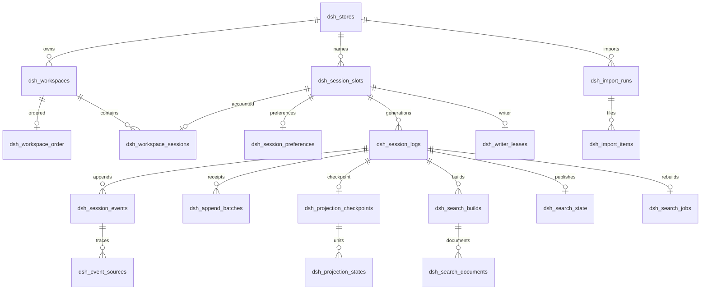

# 转储数据存储 MYSQL 表结构

本方案将 DeepSeek Harness 的工作区记录、会话投影缓存、全文搜索，以及完整会话和工具调用历史迁入 MySQL。会话事件是权威数据，投影与搜索索引可由事件重建。目标数据库为 MySQL 8.4，存储引擎为 InnoDB，字符集为 utf8mb4。

设计日期为 2026 年 10 月 15 日，依据本地 `deepseek-harness` 的 `0.2.1-alpha.2` 版本，提交 `d743267388`。当前逻辑会话格式为 4，工作区领域版本为 2，投影缓存记录版本为 7；这些版本与本文的数据库结构版本独立。

本文交付可用于空库初始化的 DDL、字段与原始数据映射、索引、读写事务、搜索一致性、转储和验收方案。数据库适配插件仍需开发。附件字节、凭据、profile 配置和实际项目文件维持原有存储方式，不属于这次三类数据的转储范围。

## 设计原则

1. 完整保存 `SessionHeader`、事件 envelope、`data`、`surfaceOp`、`sourceEventSeqs`、`ignorable`、Assistant 紧凑流和工具结果元数据。消息、调用、结果、失败尝试及插件事件统一进入事件表。
2. 事件只追加，同一日志的 `seq` 从 0 连续递增。事件主键防重复，追加事务与运行时 validator 共同保证无间隙及合法的 surface 语义。
3. 原始业务 ID 保留为文本，内部关联使用整数键。较长 ID 与规范路径使用 SHA-256 生成列建立唯一索引；哈希命中后仍比较原始 UTF-8 字节，碰撞时报错，不合并记录。
4. 一个 `store` 对应一个原 Harness home 的数据空间和文件系统语义。不同主机的同名路径默认使用不同 store。Web 与 Desktop 只有在原本共享数据空间时才共用 store。该字段不是用户登录或租户授权系统。
5. 会话 ID 是可重新使用的槽位。`lifecycle_id` 区分删除后重建的生命周期，`format_version` 区分日志代际，防止旧缓存和旧写入者污染新会话。
6. 权威事件、追加回执和搜索重建任务在同一事务提交。投影、搜索重建失败可重试，不回滚已持久化事件。
7. 所有外键保留默认的限制删除行为。物理清理按依赖顺序执行；不通过级联删除意外清除会话历史。

## 表清单

| 表 | 类型 | 用途 |
|---|---|---|
| `dsh_schema_migrations` | 运维元数据 | 数据库结构版本与迁移校验和 |
| `dsh_stores` | 权威元数据 | 数据空间、工作区全局状态和搜索配置 |
| `dsh_session_slots` | 权威标识 | 业务会话 ID 与当前生命周期、代际的映射 |
| `dsh_workspaces` | 权威业务数据 | 工作区路径、标题、时间 |
| `dsh_workspace_order` | 权威业务数据 | 工作区的全局显示顺序 |
| `dsh_workspace_sessions` | 权威业务数据 | 工作区会话候选账本及会话顺序 |
| `dsh_session_preferences` | 权威业务数据 | 全局归档集合及置顶顺序 |
| `dsh_session_logs` | 权威业务数据 | 每个生命周期、格式代际的不可变 header 和日志水位 |
| `dsh_session_events` | 权威业务数据 | 完整事件、消息和工具轨迹 |
| `dsh_event_sources` | 派生关系 | `sourceEventSeqs` 的反向追踪索引 |
| `dsh_writer_leases` | 协调状态 | 单写者租约及单调 fencing token |
| `dsh_append_batches` | 持久回执 | 追加幂等和未知提交结果核对 |
| `dsh_projection_checkpoints` | 派生缓存 | 一次完整会话检查点的身份与版本 |
| `dsh_projection_states` | 派生缓存 | 各投影 key 的内部状态与 seq 水位 |
| `dsh_search_builds` | 派生索引 | 一个固定会话切面的搜索构建批次 |
| `dsh_search_state` | 派生索引 | 当前发布的搜索批次与索引水位 |
| `dsh_search_documents` | 派生索引 | 可搜索语义文本、surface 分类及全文索引 |
| `dsh_search_jobs` | 事务任务 | 可恢复、可合并的索引重建任务 |
| `dsh_import_runs` | 转储元数据 | 一次转储的源目录、manifest、状态和结果 |
| `dsh_import_items` | 转储元数据 | 每个源文件的哈希、目标和导入进度 |

## 主要关系



`dsh_session_slots` 允许存在尚未解析到日志的 ID，保留旧工作区账本中的失效候选项、父会话引用和归档集合。只有槽位指向已发布日志时，`SessionPersistence.stat/list/open` 才把它视为已存在会话。工作区成员读取还需校验会话 header 的规范 cwd 与工作区路径一致。

## 字段与实现约定

| 约定 | 规则 |
|---|---|
| 内部主键 | `BIGINT UNSIGNED`；Node 驱动按字符串或 bigint 读取，不能直接转为不安全的 JavaScript number |
| 业务 seq 与时间 | Unix 毫秒或事件位置，限制在 JavaScript 安全整数范围；空日志投影水位为 `-1` |
| 时间 | 业务时间来自原数据；数据库运维时间使用 UTC `DATETIME(6)`，连接设置 `time_zone='+00:00'` |
| 精确文本 | 原事件和标识采用 `utf8mb4_0900_bin`；搜索正文单独使用 `utf8mb4_0900_ai_ci` |
| 完整事件 | `event_json` 使用 LONGTEXT 加 JSON 校验，保留适配器写入的序列化文本；不将工具 arguments 强制转成 JSON 对象 |
| JSON 状态 | header、投影值和运维结构使用 JSON；JSON `null` 与 SQL NULL 分开处理 |
| 生命周期 | 由适配器生成 16 字节随机 UUID；正常恢复和版本迁移沿用，同 ID 重新创建使用新值 |
| 多列关联 | 跨 store 的关联由复合外键拒绝；所有查询也显式带上 store |
| 对外 revision | 由 store、槽位、生命周期、格式和日志 revision 组成 opaque token；租约续期、缓存刷新不改变日志 revision |
| 严格写入 | 连接启用严格 SQL 模式；权威表不使用 INSERT IGNORE 跳过错误，也不使用 REPLACE 覆盖已有事件 |

MySQL 的 JSON 类型会规范化文档，因此完整事件选择保留序列化文本，投影等只要求 JSON 值语义一致的数据使用原生 JSON。[MySQL JSON 文档](https://dev.mysql.com/doc/refman/8.4/en/json.html)

以下 DDL 的 JSON 校验用于结构下限；运行时仍需调用仓库的格式 codec 和 validator 校验扩展事件、引用、surface、流记录和序号。MySQL CHECK 对 UNKNOWN 也可放行，所以必填 JSON 路径显式检查存在性。[CHECK 约束](https://dev.mysql.com/doc/refman/8.4/en/create-table-check-constraints.html)

## 完整建表 SQL

下列 SQL 面向空库，按顺序执行。结构升级使用单独的版本迁移；MySQL DDL 有隐式提交，结构版本应在该版本所有 DDL 与校验成功后登记。

```sql
CREATE DATABASE IF NOT EXISTS deepseek_harness
  CHARACTER SET utf8mb4 COLLATE utf8mb4_0900_bin;
USE deepseek_harness;
SET NAMES utf8mb4 COLLATE utf8mb4_0900_bin;
SET time_zone = '+00:00';

CREATE TABLE dsh_schema_migrations (
  schema_version INT UNSIGNED NOT NULL COMMENT '数据库结构版本，与会话格式独立',
  migration_name VARCHAR(191) NOT NULL COMMENT '迁移名称',
  script_sha256 BINARY(32) NOT NULL COMMENT '实际迁移脚本的 SHA256',
  applied_at DATETIME(6) NOT NULL DEFAULT CURRENT_TIMESTAMP(6) COMMENT '完成时间 UTC',
  PRIMARY KEY (schema_version)
) ENGINE=InnoDB COMMENT='数据库结构迁移记录';

CREATE TABLE dsh_stores (
  store_id BIGINT UNSIGNED NOT NULL AUTO_INCREMENT COMMENT '数据空间内部主键',
  store_key VARCHAR(128) CHARACTER SET ascii COLLATE ascii_bin NOT NULL COMMENT '部署分配的稳定命名空间',
  display_name VARCHAR(255) NOT NULL COMMENT '显示名称',
  workspace_domain_version INT UNSIGNED NOT NULL DEFAULT 2 COMMENT '工作区领域版本',
  registry_initialized BOOLEAN NOT NULL DEFAULT FALSE COMMENT '原 global.initialized',
  default_workspace_external_id LONGTEXT NULL COMMENT '首次工作区 ID，删除工作区后仍保留',
  registry_revision BIGINT UNSIGNED NOT NULL DEFAULT 0 COMMENT '工作区全局状态 CAS 版本',
  search_epoch BIGINT UNSIGNED NOT NULL DEFAULT 0 COMMENT '已发布搜索语料与可见性版本',
  search_analyzer_version INT UNSIGNED NOT NULL DEFAULT 1 COMMENT 'MySQL 搜索语义配置版本',
  search_config_json JSON NOT NULL COMMENT 'ngram、停用词、提取器等配置指纹',
  created_at DATETIME(6) NOT NULL DEFAULT CURRENT_TIMESTAMP(6),
  updated_at DATETIME(6) NOT NULL DEFAULT CURRENT_TIMESTAMP(6)
    ON UPDATE CURRENT_TIMESTAMP(6),
  PRIMARY KEY (store_id),
  UNIQUE KEY uq_store_key (store_key),
  CONSTRAINT ck_store_initialized CHECK (registry_initialized IN (0,1)),
  CONSTRAINT ck_store_search_config CHECK (JSON_TYPE(search_config_json) = 'OBJECT')
) ENGINE=InnoDB COMMENT='Harness 数据空间及工作区全局状态';

CREATE TABLE dsh_session_slots (
  slot_id BIGINT UNSIGNED NOT NULL AUTO_INCREMENT COMMENT '业务会话 ID 槽位',
  store_id BIGINT UNSIGNED NOT NULL,
  external_session_id LONGTEXT NOT NULL COMMENT '原 SessionId，按 UTF8 字节保留',
  external_id_hash BINARY(32)
    GENERATED ALWAYS AS (UNHEX(SHA2(external_session_id,256))) STORED,
  current_lifecycle_id BINARY(16) NULL COMMENT '当前生命周期，未解析或已删除时为空',
  current_format_version INT UNSIGNED NULL COMMENT '当前已发布日志版本',
  created_at DATETIME(6) NOT NULL DEFAULT CURRENT_TIMESTAMP(6),
  updated_at DATETIME(6) NOT NULL DEFAULT CURRENT_TIMESTAMP(6)
    ON UPDATE CURRENT_TIMESTAMP(6),
  PRIMARY KEY (slot_id),
  UNIQUE KEY uq_slot_store_pk (store_id,slot_id),
  UNIQUE KEY uq_slot_external (store_id,external_id_hash),
  CONSTRAINT fk_slot_store FOREIGN KEY (store_id) REFERENCES dsh_stores(store_id),
  CONSTRAINT ck_slot_id CHECK (OCTET_LENGTH(external_session_id) > 0),
  CONSTRAINT ck_slot_pointer CHECK (
    (current_lifecycle_id IS NULL AND current_format_version IS NULL) OR
    (current_lifecycle_id IS NOT NULL AND current_format_version IS NOT NULL)
  )
) ENGINE=InnoDB COMMENT='业务会话 ID 到当前生命周期及代际的映射';

CREATE TABLE dsh_workspaces (
  workspace_pk BIGINT UNSIGNED NOT NULL AUTO_INCREMENT,
  store_id BIGINT UNSIGNED NOT NULL,
  external_workspace_id LONGTEXT NOT NULL COMMENT '原 WorkspaceId',
  external_id_hash BINARY(32)
    GENERATED ALWAYS AS (UNHEX(SHA2(external_workspace_id,256))) STORED,
  canonical_path LONGTEXT NOT NULL COMMENT '原 fs.realpath 规范路径，不由数据库改变大小写',
  path_hash BINARY(32)
    GENERATED ALWAYS AS (UNHEX(SHA2(canonical_path,256))) STORED,
  title LONGTEXT NOT NULL COMMENT '原显示标题',
  created_at_iso VARCHAR(64) CHARACTER SET ascii COLLATE ascii_bin NOT NULL COMMENT '原 ISO8601 文本',
  updated_at_iso VARCHAR(64) CHARACTER SET ascii COLLATE ascii_bin NOT NULL COMMENT '原 ISO8601 文本',
  record_revision BIGINT UNSIGNED NOT NULL DEFAULT 1 COMMENT '记录 CAS 版本',
  PRIMARY KEY (workspace_pk),
  UNIQUE KEY uq_workspace_store_pk (store_id,workspace_pk),
  UNIQUE KEY uq_workspace_external (store_id,external_id_hash),
  UNIQUE KEY uq_workspace_path (store_id,path_hash),
  CONSTRAINT fk_workspace_store FOREIGN KEY (store_id) REFERENCES dsh_stores(store_id),
  CONSTRAINT ck_workspace_id CHECK (OCTET_LENGTH(external_workspace_id) > 0),
  CONSTRAINT ck_workspace_path CHECK (OCTET_LENGTH(canonical_path) > 0)
) ENGINE=InnoDB COMMENT='工作区权威记录';

CREATE TABLE dsh_workspace_order (
  store_id BIGINT UNSIGNED NOT NULL,
  workspace_pk BIGINT UNSIGNED NOT NULL,
  position_no BIGINT UNSIGNED NOT NULL COMMENT '原 global.workspaceIds 的零基位置',
  PRIMARY KEY (store_id,workspace_pk),
  UNIQUE KEY uq_workspace_order (store_id,position_no),
  CONSTRAINT fk_workspace_order FOREIGN KEY (store_id,workspace_pk)
    REFERENCES dsh_workspaces(store_id,workspace_pk)
) ENGINE=InnoDB COMMENT='工作区全局顺序';

CREATE TABLE dsh_workspace_sessions (
  store_id BIGINT UNSIGNED NOT NULL,
  workspace_pk BIGINT UNSIGNED NOT NULL,
  slot_id BIGINT UNSIGNED NOT NULL,
  position_no BIGINT UNSIGNED NOT NULL COMMENT '原 workspace.sessionIds 的候选位置',
  PRIMARY KEY (store_id,workspace_pk,slot_id),
  UNIQUE KEY uq_session_one_workspace (store_id,slot_id),
  UNIQUE KEY uq_workspace_session_order (store_id,workspace_pk,position_no),
  CONSTRAINT fk_ws_session_workspace FOREIGN KEY (store_id,workspace_pk)
    REFERENCES dsh_workspaces(store_id,workspace_pk),
  CONSTRAINT fk_ws_session_slot FOREIGN KEY (store_id,slot_id)
    REFERENCES dsh_session_slots(store_id,slot_id)
) ENGINE=InnoDB COMMENT='工作区有序会话候选账本';

CREATE TABLE dsh_session_preferences (
  store_id BIGINT UNSIGNED NOT NULL,
  slot_id BIGINT UNSIGNED NOT NULL,
  is_archived BOOLEAN NOT NULL DEFAULT FALSE COMMENT '原全局 archivedSessionIds 集合',
  pin_position BIGINT UNSIGNED NULL COMMENT '原全局 pinnedSessionIds 顺序，空表示未置顶',
  updated_at DATETIME(6) NOT NULL DEFAULT CURRENT_TIMESTAMP(6)
    ON UPDATE CURRENT_TIMESTAMP(6),
  PRIMARY KEY (store_id,slot_id),
  UNIQUE KEY uq_pin_order (store_id,pin_position),
  KEY ix_archived (store_id,is_archived,slot_id),
  CONSTRAINT fk_preferences_slot FOREIGN KEY (store_id,slot_id)
    REFERENCES dsh_session_slots(store_id,slot_id),
  CONSTRAINT ck_archived CHECK (is_archived IN (0,1)),
  CONSTRAINT ck_archive_pin CHECK (is_archived = 0 OR pin_position IS NULL)
) ENGINE=InnoDB COMMENT='会话归档与置顶，独立于工作区顺序';

CREATE TABLE dsh_session_logs (
  store_id BIGINT UNSIGNED NOT NULL,
  slot_id BIGINT UNSIGNED NOT NULL,
  lifecycle_id BINARY(16) NOT NULL,
  format_version INT UNSIGNED NOT NULL COMMENT '当前源码为4，后续版本逐代新增',
  log_state VARCHAR(16) CHARACTER SET ascii COLLATE ascii_bin NOT NULL COMMENT 'staging/active/sealed/quarantined',
  header_json JSON NOT NULL COMMENT '完整不可变 SessionHeader',
  session_created_at_ms BIGINT UNSIGNED NOT NULL COMMENT 'header.createdAt',
  initial_cwd LONGTEXT NULL COMMENT 'header.cwd；SQL NULL 表示字段缺省',
  cwd_hash BINARY(32)
    GENERATED ALWAYS AS (UNHEX(SHA2(initial_cwd,256))) STORED,
  parent_slot_id BIGINT UNSIGNED NULL COMMENT 'header.parentSession 对应槽位，不等同于所有 subagent 父级',
  is_seeded BOOLEAN NOT NULL COMMENT 'header.isSeeded',
  inherited_event_count BIGINT UNSIGNED NOT NULL DEFAULT 0 COMMENT '精确 Fork 继承前缀长度，独立于 header',
  origin VARCHAR(32) CHARACTER SET ascii COLLATE ascii_bin NULL COMMENT '当前为 subagent 或缺省',
  delegation_depth BIGINT UNSIGNED NULL COMMENT '保留缺省与显式0的区别',
  agent_preset LONGTEXT NULL COMMENT 'header.agentPreset',
  event_count BIGINT UNSIGNED NOT NULL DEFAULT 0 COMMENT '已提交事件数量，同时是下一合法 seq',
  log_revision BIGINT UNSIGNED NOT NULL DEFAULT 1 COMMENT '只有日志或代际内容变化才改变',
  created_at DATETIME(6) NOT NULL DEFAULT CURRENT_TIMESTAMP(6),
  updated_at DATETIME(6) NOT NULL DEFAULT CURRENT_TIMESTAMP(6)
    ON UPDATE CURRENT_TIMESTAMP(6),
  PRIMARY KEY (store_id,slot_id,lifecycle_id,format_version),
  KEY ix_log_created (store_id,session_created_at_ms,slot_id),
  KEY ix_log_cwd (store_id,cwd_hash,slot_id),
  KEY ix_log_parent (store_id,parent_slot_id,slot_id),
  CONSTRAINT fk_log_slot FOREIGN KEY (store_id,slot_id)
    REFERENCES dsh_session_slots(store_id,slot_id),
  CONSTRAINT fk_log_parent FOREIGN KEY (store_id,parent_slot_id)
    REFERENCES dsh_session_slots(store_id,slot_id),
  CONSTRAINT ck_log_state CHECK (log_state IN ('staging','active','sealed','quarantined')),
  CONSTRAINT ck_log_seed CHECK (is_seeded IN (0,1) AND (is_seeded = 1 OR inherited_event_count = 0)),
  CONSTRAINT ck_log_inherited CHECK (inherited_event_count <= event_count),
  CONSTRAINT ck_log_numbers CHECK (
    session_created_at_ms <= 9007199254740991 AND event_count <= 9007199254740991
    AND (delegation_depth IS NULL OR delegation_depth <= 9007199254740991)
  ),
  CONSTRAINT ck_log_header CHECK (
    JSON_TYPE(header_json) = 'OBJECT'
    AND JSON_CONTAINS_PATH(header_json,'all','$.id','$.version','$.createdAt','$.isSeeded') = 1
    AND JSON_TYPE(JSON_EXTRACT(header_json,'$.id')) = 'STRING'
    AND JSON_TYPE(JSON_EXTRACT(header_json,'$.version')) = 'INTEGER'
    AND JSON_TYPE(JSON_EXTRACT(header_json,'$.createdAt')) = 'INTEGER'
    AND JSON_TYPE(JSON_EXTRACT(header_json,'$.isSeeded')) = 'BOOLEAN'
    AND CAST(JSON_UNQUOTE(JSON_EXTRACT(header_json,'$.version')) AS UNSIGNED) = format_version
    AND CAST(JSON_UNQUOTE(JSON_EXTRACT(header_json,'$.createdAt')) AS UNSIGNED) = session_created_at_ms
  )
) ENGINE=InnoDB COMMENT='会话生命周期及格式代际';

ALTER TABLE dsh_session_slots
  ADD CONSTRAINT fk_slot_current_log
  FOREIGN KEY (store_id,slot_id,current_lifecycle_id,current_format_version)
  REFERENCES dsh_session_logs(store_id,slot_id,lifecycle_id,format_version);

CREATE TABLE dsh_session_events (
  store_id BIGINT UNSIGNED NOT NULL,
  slot_id BIGINT UNSIGNED NOT NULL,
  lifecycle_id BINARY(16) NOT NULL,
  format_version INT UNSIGNED NOT NULL,
  seq BIGINT UNSIGNED NOT NULL COMMENT '从0连续递增',
  event_type VARCHAR(191) NOT NULL COMMENT '完整事件类型，保留插件扩展',
  event_time_ms BIGINT UNSIGNED NOT NULL COMMENT '原 event.time',
  turn_no BIGINT UNSIGNED NULL COMMENT '仅在原事件有该字段时提取',
  step_no BIGINT UNSIGNED NULL COMMENT '仅在原事件有该字段时提取',
  ignorable BOOLEAN NOT NULL DEFAULT FALSE COMMENT '导出时 false 还原为字段缺省',
  surface_op VARCHAR(12) CHARACTER SET ascii COLLATE ascii_bin NOT NULL DEFAULT 'none',
  replace_start_seq BIGINT UNSIGNED NULL,
  replace_end_seq BIGINT UNSIGNED NULL,
  event_json LONGTEXT NOT NULL COMMENT '完整原事件的适配器序列化文本',
  event_sha256 BINARY(32)
    GENERATED ALWAYS AS (UNHEX(SHA2(event_json,256))) STORED,
  PRIMARY KEY (store_id,slot_id,lifecycle_id,format_version,seq),
  KEY ix_event_type (store_id,slot_id,lifecycle_id,format_version,event_type,seq),
  KEY ix_event_time (store_id,slot_id,lifecycle_id,format_version,event_time_ms,seq),
  KEY ix_event_step (store_id,slot_id,lifecycle_id,format_version,turn_no,step_no,seq),
  CONSTRAINT fk_event_log FOREIGN KEY (store_id,slot_id,lifecycle_id,format_version)
    REFERENCES dsh_session_logs(store_id,slot_id,lifecycle_id,format_version),
  CONSTRAINT ck_event_numbers CHECK (
    seq <= 9007199254740991 AND event_time_ms <= 9007199254740991
    AND (turn_no IS NULL OR turn_no <= 9007199254740991)
    AND (step_no IS NULL OR step_no <= 9007199254740991)
  ),
  CONSTRAINT ck_event_ignorable CHECK (ignorable IN (0,1)),
  CONSTRAINT ck_event_surface CHECK (
    (surface_op IN ('none','append') AND replace_start_seq IS NULL AND replace_end_seq IS NULL)
    OR (surface_op = 'replace' AND replace_start_seq IS NOT NULL AND replace_end_seq IS NOT NULL
        AND replace_start_seq <= replace_end_seq AND replace_end_seq < seq)
  ),
  CONSTRAINT ck_event_json CHECK (
    JSON_VALID(event_json) = 1
    AND JSON_TYPE(event_json) = 'OBJECT'
    AND JSON_CONTAINS_PATH(event_json,'all','$.seq','$.type','$.time','$.data') = 1
    AND JSON_TYPE(JSON_EXTRACT(event_json,'$.seq')) = 'INTEGER'
    AND JSON_TYPE(JSON_EXTRACT(event_json,'$.time')) = 'INTEGER'
    AND JSON_TYPE(JSON_EXTRACT(event_json,'$.type')) = 'STRING'
    AND CAST(JSON_UNQUOTE(JSON_EXTRACT(event_json,'$.seq')) AS UNSIGNED) = seq
    AND CAST(JSON_UNQUOTE(JSON_EXTRACT(event_json,'$.time')) AS UNSIGNED) = event_time_ms
    AND CAST(JSON_UNQUOTE(JSON_EXTRACT(event_json,'$.type')) AS BINARY) = CAST(event_type AS BINARY)
  )
) ENGINE=InnoDB COMMENT='仅追加的完整会话事件';

CREATE TABLE dsh_event_sources (
  store_id BIGINT UNSIGNED NOT NULL,
  slot_id BIGINT UNSIGNED NOT NULL,
  lifecycle_id BINARY(16) NOT NULL,
  format_version INT UNSIGNED NOT NULL,
  target_seq BIGINT UNSIGNED NOT NULL COMMENT '引用来源的事件',
  source_seq BIGINT UNSIGNED NOT NULL COMMENT '被引用的早期事件',
  PRIMARY KEY (store_id,slot_id,lifecycle_id,format_version,target_seq,source_seq),
  KEY ix_source_reverse (store_id,slot_id,lifecycle_id,format_version,source_seq,target_seq),
  CONSTRAINT fk_source_target FOREIGN KEY (store_id,slot_id,lifecycle_id,format_version,target_seq)
    REFERENCES dsh_session_events(store_id,slot_id,lifecycle_id,format_version,seq),
  CONSTRAINT fk_source_origin FOREIGN KEY (store_id,slot_id,lifecycle_id,format_version,source_seq)
    REFERENCES dsh_session_events(store_id,slot_id,lifecycle_id,format_version,seq),
  CONSTRAINT ck_source_before CHECK (source_seq < target_seq)
) ENGINE=InnoDB COMMENT='sourceEventSeqs 派生追踪边';

CREATE TABLE dsh_writer_leases (
  store_id BIGINT UNSIGNED NOT NULL,
  slot_id BIGINT UNSIGNED NOT NULL,
  fence_token BIGINT UNSIGNED NOT NULL DEFAULT 0 COMMENT '每次重新取得所有权递增，释放不归零',
  owner_token BINARY(16) NULL COMMENT '当前写句柄随机身份',
  lifecycle_id BINARY(16) NULL COMMENT '写句柄绑定的生命周期',
  expires_at DATETIME(6) NULL COMMENT '以数据库 UTC 时间判定',
  owner_label VARCHAR(191) NULL COMMENT '实例诊断名称',
  PRIMARY KEY (store_id,slot_id),
  CONSTRAINT fk_lease_slot FOREIGN KEY (store_id,slot_id)
    REFERENCES dsh_session_slots(store_id,slot_id),
  CONSTRAINT ck_lease_complete CHECK (
    (owner_token IS NULL AND lifecycle_id IS NULL AND expires_at IS NULL)
    OR (owner_token IS NOT NULL AND lifecycle_id IS NOT NULL AND expires_at IS NOT NULL)
  )
) ENGINE=InnoDB COMMENT='跨 Host 单写者租约';

CREATE TABLE dsh_append_batches (
  store_id BIGINT UNSIGNED NOT NULL,
  slot_id BIGINT UNSIGNED NOT NULL,
  lifecycle_id BINARY(16) NOT NULL,
  format_version INT UNSIGNED NOT NULL,
  batch_id BINARY(16) NOT NULL COMMENT '重试沿用同一个 UUID',
  first_seq BIGINT UNSIGNED NOT NULL,
  batch_event_count BIGINT UNSIGNED NOT NULL,
  payload_sha256 BINARY(32) NOT NULL COMMENT '按协议序列化的完整批次哈希',
  committed_revision BIGINT UNSIGNED NOT NULL,
  writer_fence BIGINT UNSIGNED NOT NULL,
  committed_at DATETIME(6) NOT NULL DEFAULT CURRENT_TIMESTAMP(6),
  PRIMARY KEY (store_id,slot_id,lifecycle_id,format_version,batch_id),
  UNIQUE KEY uq_batch_start (store_id,slot_id,lifecycle_id,format_version,first_seq),
  CONSTRAINT fk_batch_log FOREIGN KEY (store_id,slot_id,lifecycle_id,format_version)
    REFERENCES dsh_session_logs(store_id,slot_id,lifecycle_id,format_version),
  CONSTRAINT ck_batch_count CHECK (
    batch_event_count > 0 AND first_seq <= 9007199254740991
    AND batch_event_count <= 9007199254740991 - first_seq
  )
) ENGINE=InnoDB COMMENT='追加事务的幂等回执';

CREATE TABLE dsh_projection_checkpoints (
  store_id BIGINT UNSIGNED NOT NULL,
  slot_id BIGINT UNSIGNED NOT NULL,
  lifecycle_id BINARY(16) NOT NULL,
  format_version INT UNSIGNED NOT NULL,
  cache_record_version INT UNSIGNED NOT NULL COMMENT '当前为7，兼容旧版本由适配器判断',
  identity_json JSON NOT NULL COMMENT '原 checkpoint.identity 的完整值',
  checkpoint_revision BIGINT UNSIGNED NOT NULL COMMENT '整份检查点 CAS 版本',
  observed_log_revision BIGINT UNSIGNED NOT NULL COMMENT '计算检查点时观察到的日志版本',
  observed_event_count BIGINT UNSIGNED NOT NULL COMMENT '不可变输入前缀长度',
  unit_count INT UNSIGNED NOT NULL COMMENT '本次完整检查点 key 数量，可为0',
  written_at DATETIME(6) NOT NULL DEFAULT CURRENT_TIMESTAMP(6),
  PRIMARY KEY (store_id,slot_id,lifecycle_id,format_version),
  CONSTRAINT fk_checkpoint_log FOREIGN KEY (store_id,slot_id,lifecycle_id,format_version)
    REFERENCES dsh_session_logs(store_id,slot_id,lifecycle_id,format_version),
  CONSTRAINT ck_checkpoint_identity CHECK (
    JSON_TYPE(identity_json) = 'OBJECT'
    AND JSON_CONTAINS_PATH(identity_json,'all','$.formatVersion','$.createdAt','$.isSeeded','$.inheritedEventCount') = 1
  ),
  CONSTRAINT ck_checkpoint_count CHECK (observed_event_count <= 9007199254740991)
) ENGINE=InnoDB COMMENT='绑定日志身份的整份投影检查点';

CREATE TABLE dsh_projection_states (
  store_id BIGINT UNSIGNED NOT NULL,
  slot_id BIGINT UNSIGNED NOT NULL,
  lifecycle_id BINARY(16) NOT NULL,
  format_version INT UNSIGNED NOT NULL,
  projection_key VARCHAR(191) NOT NULL COMMENT 'title/model/preset 等动态 key',
  state_version INT UNSIGNED NOT NULL COMMENT '原 row.ver，独立于记录版本',
  last_seq BIGINT NOT NULL COMMENT '原 row.seq，空输入为-1',
  state_json JSON NOT NULL COMMENT '原 row.val：内部状态，可为 JSON null',
  PRIMARY KEY (store_id,slot_id,lifecycle_id,format_version,projection_key),
  CONSTRAINT fk_projection_checkpoint FOREIGN KEY (store_id,slot_id,lifecycle_id,format_version)
    REFERENCES dsh_projection_checkpoints(store_id,slot_id,lifecycle_id,format_version),
  CONSTRAINT ck_projection_seq CHECK (last_seq >= -1 AND last_seq <= 9007199254740991)
) ENGINE=InnoDB COMMENT='完整检查点中的各投影单元状态';

CREATE TABLE dsh_search_builds (
  store_id BIGINT UNSIGNED NOT NULL,
  slot_id BIGINT UNSIGNED NOT NULL,
  lifecycle_id BINARY(16) NOT NULL,
  format_version INT UNSIGNED NOT NULL,
  build_id BINARY(16) NOT NULL,
  source_log_revision BIGINT UNSIGNED NOT NULL,
  source_event_count BIGINT UNSIGNED NOT NULL COMMENT '本次只读取 seq 小于此值的前缀',
  extractor_version INT UNSIGNED NOT NULL COMMENT '语义文本与 surface 提取器版本',
  analyzer_version INT UNSIGNED NOT NULL COMMENT '全文分词语义版本',
  build_state VARCHAR(12) CHARACTER SET ascii COLLATE ascii_bin NOT NULL COMMENT 'staging/published/retired',
  document_count BIGINT UNSIGNED NOT NULL DEFAULT 0,
  created_at DATETIME(6) NOT NULL DEFAULT CURRENT_TIMESTAMP(6),
  published_at DATETIME(6) NULL,
  PRIMARY KEY (store_id,slot_id,lifecycle_id,format_version,build_id),
  KEY ix_build_cleanup (store_id,build_state,created_at),
  CONSTRAINT fk_build_log FOREIGN KEY (store_id,slot_id,lifecycle_id,format_version)
    REFERENCES dsh_session_logs(store_id,slot_id,lifecycle_id,format_version),
  CONSTRAINT ck_build_state CHECK (build_state IN ('staging','published','retired')),
  CONSTRAINT ck_build_count CHECK (source_event_count <= 9007199254740991)
) ENGINE=InnoDB COMMENT='固定日志前缀的语义搜索构建批次';

CREATE TABLE dsh_search_state (
  store_id BIGINT UNSIGNED NOT NULL,
  slot_id BIGINT UNSIGNED NOT NULL,
  lifecycle_id BINARY(16) NOT NULL,
  format_version INT UNSIGNED NOT NULL,
  active_build_id BINARY(16) NULL COMMENT '空表示尚未发布搜索文档',
  indexed_log_revision BIGINT UNSIGNED NULL,
  indexed_event_count BIGINT UNSIGNED NOT NULL DEFAULT 0,
  state_revision BIGINT UNSIGNED NOT NULL DEFAULT 0 COMMENT '发布 CAS 版本',
  updated_at DATETIME(6) NOT NULL DEFAULT CURRENT_TIMESTAMP(6)
    ON UPDATE CURRENT_TIMESTAMP(6),
  PRIMARY KEY (store_id,slot_id,lifecycle_id,format_version),
  CONSTRAINT fk_search_state_log FOREIGN KEY (store_id,slot_id,lifecycle_id,format_version)
    REFERENCES dsh_session_logs(store_id,slot_id,lifecycle_id,format_version),
  CONSTRAINT fk_search_state_build FOREIGN KEY (store_id,slot_id,lifecycle_id,format_version,active_build_id)
    REFERENCES dsh_search_builds(store_id,slot_id,lifecycle_id,format_version,build_id),
  CONSTRAINT ck_search_state_pointer CHECK (
    (active_build_id IS NULL AND indexed_log_revision IS NULL AND indexed_event_count = 0)
    OR (active_build_id IS NOT NULL AND indexed_log_revision IS NOT NULL)
  ),
  CONSTRAINT ck_search_state_count CHECK (indexed_event_count <= 9007199254740991)
) ENGINE=InnoDB COMMENT='当前可见的搜索构建及索引水位';

CREATE TABLE dsh_search_documents (
  document_id BIGINT UNSIGNED NOT NULL AUTO_INCREMENT,
  store_id BIGINT UNSIGNED NOT NULL,
  slot_id BIGINT UNSIGNED NOT NULL,
  lifecycle_id BINARY(16) NOT NULL,
  format_version INT UNSIGNED NOT NULL,
  build_id BINARY(16) NOT NULL,
  event_seq BIGINT UNSIGNED NOT NULL,
  surface_class VARCHAR(12) CHARACTER SET ascii COLLATE ascii_bin NOT NULL COMMENT 'current/shadowed/log-only',
  body LONGTEXT CHARACTER SET utf8mb4 COLLATE utf8mb4_0900_ai_ci NOT NULL,
  codepoint_length BIGINT UNSIGNED NOT NULL COMMENT 'Unicode code point 数量',
  PRIMARY KEY (document_id),
  UNIQUE KEY uq_document_event (store_id,slot_id,lifecycle_id,format_version,build_id,event_seq),
  KEY ix_document_scope (store_id,slot_id,lifecycle_id,format_version,build_id,surface_class,event_seq),
  FULLTEXT KEY ft_document_body (body) WITH PARSER ngram,
  CONSTRAINT fk_document_build FOREIGN KEY (store_id,slot_id,lifecycle_id,format_version,build_id)
    REFERENCES dsh_search_builds(store_id,slot_id,lifecycle_id,format_version,build_id),
  CONSTRAINT fk_document_event FOREIGN KEY (store_id,slot_id,lifecycle_id,format_version,event_seq)
    REFERENCES dsh_session_events(store_id,slot_id,lifecycle_id,format_version,seq),
  CONSTRAINT ck_document_surface CHECK (surface_class IN ('current','shadowed','log-only')),
  CONSTRAINT ck_document_length CHECK (codepoint_length = CHAR_LENGTH(body))
) ENGINE=InnoDB COMMENT='可重建的全文搜索语义文档';

CREATE TABLE dsh_search_jobs (
  store_id BIGINT UNSIGNED NOT NULL,
  slot_id BIGINT UNSIGNED NOT NULL,
  lifecycle_id BINARY(16) NOT NULL,
  format_version INT UNSIGNED NOT NULL,
  target_log_revision BIGINT UNSIGNED NOT NULL,
  target_event_count BIGINT UNSIGNED NOT NULL,
  job_state VARCHAR(12) CHARACTER SET ascii COLLATE ascii_bin NOT NULL COMMENT 'pending/running/retry/done',
  available_at DATETIME(6) NOT NULL DEFAULT CURRENT_TIMESTAMP(6),
  claim_token BINARY(16) NULL,
  claim_expires_at DATETIME(6) NULL,
  attempts INT UNSIGNED NOT NULL DEFAULT 0,
  last_error_json JSON NULL,
  updated_at DATETIME(6) NOT NULL DEFAULT CURRENT_TIMESTAMP(6)
    ON UPDATE CURRENT_TIMESTAMP(6),
  PRIMARY KEY (store_id,slot_id,lifecycle_id,format_version),
  KEY ix_job_ready (job_state,available_at,store_id,slot_id),
  KEY ix_job_expired (job_state,claim_expires_at),
  CONSTRAINT fk_search_job_log FOREIGN KEY (store_id,slot_id,lifecycle_id,format_version)
    REFERENCES dsh_session_logs(store_id,slot_id,lifecycle_id,format_version),
  CONSTRAINT ck_job_state CHECK (job_state IN ('pending','running','retry','done')),
  CONSTRAINT ck_job_claim CHECK (
    (job_state = 'running' AND claim_token IS NOT NULL AND claim_expires_at IS NOT NULL)
    OR (job_state <> 'running' AND claim_token IS NULL AND claim_expires_at IS NULL)
  ),
  CONSTRAINT ck_job_count CHECK (target_event_count <= 9007199254740991)
) ENGINE=InnoDB COMMENT='与事件提交同事务的索引重建任务';

CREATE TABLE dsh_import_runs (
  import_id BINARY(16) NOT NULL,
  store_id BIGINT UNSIGNED NOT NULL,
  source_root LONGTEXT NOT NULL COMMENT '冻结的原 Harness home 或其备份目录',
  manifest_sha256 BINARY(32) NOT NULL,
  source_metadata_json JSON NOT NULL COMMENT '程序版本、来源和一致性检查点',
  run_state VARCHAR(16) CHARACTER SET ascii COLLATE ascii_bin NOT NULL,
  result_json JSON NULL COMMENT '数量、校验汇总与结果',
  started_at DATETIME(6) NOT NULL DEFAULT CURRENT_TIMESTAMP(6),
  finished_at DATETIME(6) NULL,
  PRIMARY KEY (import_id),
  UNIQUE KEY uq_import_store (store_id,import_id),
  KEY ix_import_state (store_id,run_state,started_at),
  CONSTRAINT fk_import_store FOREIGN KEY (store_id) REFERENCES dsh_stores(store_id),
  CONSTRAINT ck_import_state CHECK (run_state IN ('planned','running','validating','completed','failed'))
) ENGINE=InnoDB COMMENT='一次可恢复的数据转储';

CREATE TABLE dsh_import_items (
  import_id BINARY(16) NOT NULL,
  item_no BIGINT UNSIGNED NOT NULL,
  store_id BIGINT UNSIGNED NOT NULL,
  item_kind VARCHAR(32) CHARACTER SET ascii COLLATE ascii_bin NOT NULL,
  source_uri LONGTEXT NOT NULL COMMENT '保留的源文件或归档 URI',
  source_uri_hash BINARY(32)
    GENERATED ALWAYS AS (UNHEX(SHA2(source_uri,256))) STORED,
  source_sha256 BINARY(32) NOT NULL COMMENT '源文件原始字节哈希',
  source_size_bytes BIGINT UNSIGNED NOT NULL,
  source_format_version INT UNSIGNED NULL,
  source_session_id LONGTEXT NULL,
  target_slot_id BIGINT UNSIGNED NULL,
  target_lifecycle_id BINARY(16) NULL,
  target_format_version INT UNSIGNED NULL,
  last_imported_seq BIGINT NOT NULL DEFAULT -1,
  item_state VARCHAR(16) CHARACTER SET ascii COLLATE ascii_bin NOT NULL,
  error_json JSON NULL,
  updated_at DATETIME(6) NOT NULL DEFAULT CURRENT_TIMESTAMP(6)
    ON UPDATE CURRENT_TIMESTAMP(6),
  PRIMARY KEY (import_id,item_no),
  UNIQUE KEY uq_import_source (import_id,source_uri_hash),
  KEY ix_import_item_state (import_id,item_state,item_no),
  CONSTRAINT fk_import_item_run FOREIGN KEY (store_id,import_id)
    REFERENCES dsh_import_runs(store_id,import_id),
  CONSTRAINT fk_import_item_slot FOREIGN KEY (store_id,target_slot_id)
    REFERENCES dsh_session_slots(store_id,slot_id),
  CONSTRAINT ck_import_item_kind CHECK (item_kind IN ('workspace','workspace_state','session_log','projection_cache')),
  CONSTRAINT ck_import_item_state CHECK (item_state IN ('pending','importing','done','failed','quarantined')),
  CONSTRAINT ck_import_item_seq CHECK (last_imported_seq >= -1 AND last_imported_seq <= 9007199254740991)
) ENGINE=InnoDB COMMENT='按源文件记录转储进度与校验';
```

20 张表的每个字段均在 DDL 中给出类型、可空性、默认值和用途。`dsh_stores` 初始化时应同时记录搜索配置，例如 `JSON_OBJECT('ngramTokenSize',2,'stopwords',false,'extractorVersion',1)`。数据库结构迁移校验和由部署工具对实际执行脚本计算，不填写固定示例哈希。

## 原字段映射

### 工作区与全局状态

| 原字段 | MySQL 位置 | 保留规则 |
|---|---|---|
| 工作区记录 key | `dsh_workspaces.external_workspace_id` | 原 ID 原样保留 |
| `path` | `canonical_path` | 保留原规范路径，按 UTF-8 字节判重 |
| `title` | `title` | 不裁剪、不强制唯一 |
| `createdAt`、`updatedAt` | 两个 `*_at_iso` | 保留源 ISO 文本；超过声明长度或不合法时导入报错，不截断 |
| `sessionIds[]` | `dsh_workspace_sessions` | 数组顺序映射 `position_no`，包含未解析候选 ID |
| `initialized` | `dsh_stores.registry_initialized` | 区分合法空库与需要首次引导 |
| `defaultWorkspaceId` | `default_workspace_external_id` | 无外键，删除工作区后仍保留首次身份 |
| `workspaceIds[]` | `dsh_workspace_order` | 保持权威显示顺序 |
| `archivedSessionIds[]` | `is_archived=1` | 归档不删除工作区会话位置 |
| `pinnedSessionIds[]` | `pin_position` | 保留置顶顺序；归档时清除置顶 |
| `pendingMutation` | 导入时恢复，来源归档保留 | MySQL 新写入由事务保证记录与顺序原子更新，不再生成两写恢复标记 |

工作区记录和全局顺序必须在同一事务更新。原数据如有待完成的 create/delete 标记，先按原恢复规则处理，再发布数据库工作区集合。无法确定的记录进入转储失败报告，不凭空补记录。UI 自己保存在浏览器中的临时选择和排序偏好不属于上述 Host 权威领域。

### 会话与事件

| 原字段 | MySQL 位置 |
|---|---|
| `header.id` | 槽位 `external_session_id`，同时保留在 `header_json` |
| `version`、`createdAt`、`cwd` | 日志版本、创建毫秒、初始 cwd 和完整 header |
| `parentSession` | `parent_slot_id`；缺失父日志时可创建未解析槽位 |
| `isSeeded`、精确继承长度 | `is_seeded`、`inherited_event_count` |
| `origin`、`delegationDepth`、`agentPreset` | 对应可空列，并保留完整 header |
| `seq`、`type`、`time` | 事件索引列及 `event_json` |
| `data` 与所有扩展字段 | `event_json` |
| `surfaceOp` | 原 JSON，加 `surface_op` 与替换端点索引列 |
| `sourceEventSeqs` | 原 JSON，加 `dsh_event_sources` |
| `ignorable` | 原 JSON，加布尔索引字段 |
| `assistant/message`、`assistant/attempt` 的 `stream` | 完整保留在事件 JSON，不拆成逐 token 持久行 |
| 工具 `callId`、`name`、`arguments` | 保留 `tool/call.data`，arguments 始终按原字符串保存 |
| 工具结果、`isError`、`error`、`meta` | 保留 `tool/result.data`，不丢弃 UI 元数据 |

工具 arguments 可能是模型输出的无效 JSON 字符串，不能以数据库 JSON 对象列替换它。`callId` 也不承担全库唯一键职责，配对时必须结合会话、步骤和调用事件位置。消息的 content block、图片引用、用量和中断信息全部由完整事件承载。

`header_json` 是 header 的权威完整值，抽取列只用于索引；写入适配器验证它们一致。事件的完整 JSON 与所有抽取列也必须一致。表上的检查不是跨事件语义验证的替代品。

### 投影缓存

原 `{identity, rows: {key: {ver,seq,val}}}` 分成检查点头和多条状态行。`val` 是投影内部状态，不能用裁剪后的 UI wire 值替换。`seq=-1`、JSON `null`、缺失 key 是不同状态。

当前记录版本 7 写入完整 identity。旧版本 3～6 只有经原兼容规则确认的内容才可使用；缺少格式身份、生命周期不匹配或单元 `ver` 失配时，丢弃缓存并重放事件。该动作不丢失权威历史，也不把缓存升级当作事件格式迁移。

## 读写与并发协议

### 创建与恢复

`create` 先解析业务 ID 槽位；当前指针已存在则返回 AlreadyExists。新建随机 lifecycle，写入 staging 日志及 Fork seed，校验成功后原子发布。空会话也可以立即提交，持久性强于原后端的延迟实体化。

`open(read)` 固定当前 `(slot,lifecycle,format)`，随后从该日志读取，允许与写句柄并存。`open(write)` 还必须取得租约。普通恢复沿用 lifecycle；同 ID 在清空当前指针后重新创建，必须分配新 lifecycle。旧读句柄不能自动跳转到新生命周期。

Fork 在一个父日志前缀切面上读取，给子日志复制完整继承事件与子级标记，持久保存精确 `inherited_event_count`。不要只保存父会话 ID 和一个偏移量，否则父日志后续清理会破坏子历史。

### staging 与继承长度

DDL 要求 `inherited_event_count <= event_count`。大量 Fork 或转储分批装载时，先在未发布 staging 行设置 `inherited_event_count=0`，分批插入完整前缀并推进 `event_count`；最后一次事务写入真实继承长度、校验标记与 header，再发布。staging 对普通读取不可见。新建空 seeded 日志只有真实继承长度为 0 时才能发布。

### 单写者租约

每个槽位保留一行 lease，释放时只清空 owner 和到期时间，保留 `fence_token`。所有获取、续期、追加、关闭操作按槽位行、租约行、日志行的顺序加锁。

1. 锁定槽位，确认当前 lifecycle 与格式；确保 lease 行存在。
2. 对 lease 执行 `SELECT ... FOR UPDATE`。没有未过期 owner 时，增加 fence，写入新 owner、绑定 lifecycle 和数据库到期时间。
3. 写句柄保存 owner、fence、lifecycle。每次追加在事务中验证三者和 `expires_at > UTC_TIMESTAMP(6)`，并续期。
4. 验证失败时返回 OwnershipLost，停止该句柄的后续写入；不能自动换 owner 后继续旧批次。
5. TTL 和心跳间隔是插件配置，数据库时间用于判断有效性。只持有进程内 mutex 无法约束多个 Host。

### 原子追加与未知结果

适配器给非空批次生成 `batch_id`，重试沿用同一 ID。哈希定义为 `SHA256(UTF8(JSON.stringify(events)))`，UTF-8 编码和序列化版本固定；原事件对象只序列化一次并复用该文本。

```text
BEGIN
  查询同 batch_id 的持久回执
  若回执存在且哈希相同：返回原提交结果；不同：报幂等冲突
  按顺序锁定 slot、lease、当前 log
  再查回执，处理等待锁期间已经完成的同批次提交
  验证 owner、fence、租约和生命周期
  验证 batch[0].seq = event_count，后续 seq 连续
  调用当前格式 validator，验证 surface、引用和完整事件
  插入 events 和 source edges
  推进 event_count，log_revision += 1
  插入 append_batches 回执
  合并 search_jobs 的目标 revision 与 event_count
COMMIT
```

提交响应丢失时先查询回执；不能假定失败，也不能重新执行已经发生的工具操作。幂等回执只约束日志追加，不为外部工具副作用提供 exactly-once 保证。空 append 不创建批次回执。

运行中的搜索任务被合并时，只推进目标水位，保持现有 claim。已完成或等待中的任务重新变为 pending。死锁和锁等待可以在配置的界限内重试完整事务；涉及未知 COMMIT 结果时先核对回执。追加回执至少保留到其生命周期的重试和恢复窗口结束，不能按短 TTL 删除后仍接受相同批次的重试。

`append` 在数据库提交后完成。`flush` 等待该服务已接纳的写入链和未完成事务；`close` 排空后按 owner 与 fence 条件释放租约。应用确认后持久性还依赖部署的 InnoDB、binlog 和复制确认配置；主库读后写一致性不能由异步副本替代。

### 历史读取与版本代际

以锁定的 header、revision 和 `event_count=N` 建立读取切面，只读取 `seq<N`，按 seq 升序。分页使用 seq 范围，不使用深 OFFSET。追加不会修改已有事件，因此该前缀在分页期间保持稳定。

```sql
SELECT seq,event_json
FROM dsh_session_events
WHERE store_id=? AND slot_id=? AND lifecycle_id=? AND format_version=?
  AND seq>=? AND seq<?
ORDER BY seq
LIMIT ?;
```

`stat/list` 从当前槽位和日志头读取，无需扫描事件。返回真实 eventCount；MySQL 页面占用无法等同于 JSONL 物理文件大小，所以不伪造 `SessionPersistenceSnapshot.sizeBytes`。

旧文件转储时先通过仓库 codec 解码、验证并迁移到当前逻辑格式。原始已提交 generation 文件保留在冻结源备份中，import manifest 记录其 URI 和字节哈希。未来数据库格式迁移以同 lifecycle 的新格式 staging 行构建，校验后发布新指针，旧代际 sealed，只读保留。发布的格式版本必须单调增加，不能遇到未来未知代际后回退到较旧日志。遇到未知必需事件时拒绝恢复；`ignorable:true` 的未知信息事件按原规则处理。

## 工作区与缓存事务

工作区 create/delete、全局顺序和成员账本在同一数据库事务修改。整组排序可以锁定 registry revision，删除并重建该组顺序行，避免直接交换唯一 position 引发中间冲突。提交前校验顺序无重复、无遗漏，CAS 成功后增加 registry revision。

一个会话槽位最多归属一个工作区候选账本。有效成员读取将槽位连接当前日志，要求该日志存在、已发布且 cwd 与工作区规范路径按字节相等。归档保持原成员位置并清除 pin。`default_workspace_external_id` 不绑定外键，保留删除后首次身份的原语义。

完整投影检查点更新时，先确认当前 lifecycle、格式和 identity，锁定检查点头并比较 expected checkpoint revision，在同一事务删除该头下旧状态行、插入本次完整 rows，更新 unit_count 和 revision。头与行一起提交，不能让旧 key 残留，也不能只 upsert 新 key 后遗漏删除。

检查点输入水位不得超过持久事件前缀；每行 `last_seq` 在 `[-1, observed_event_count-1]` 内。检查点允许落后于当前日志，但较旧输入不得覆盖已经写入的较新输入；旧 writer 也必须经过当前 lifecycle 和 CAS 校验。缓存失败日志告警并可重建，不能把缓存当作唯一恢复源。

## 全文搜索设计

### 语义文档与中文分词

复用仓库 `buildSessionEventSearchDocuments`、`extractSessionEventText` 和 `foldSurface`。每个有可搜索语义文本的事件对应一条文档，surface 分类为 `current`、`shadowed` 或 `log-only`。结构事件、原始 Assistant 流、reasoning 内容和未知扩展字段不会因为含字符串就自动入索引。

提取范围包括用户文本、Assistant 正文、工具名称和 arguments、工具结果正文及错误标识、Todo 文本和部分结束原因。新插件事件要搜索，需要先定义文本提取语义并增加 extractor 版本。

采用 `FULLTEXT(body) WITH PARSER ngram` 支持中文。部署配置按下面的分析器版本固定，创建索引前生效：

```ini
[mysqld]
ngram_token_size=2
innodb_ft_enable_stopword=OFF
```

ngram 大小是启动配置；变更大小、停用词规则后重建索引。两个字符的 token 对单字、很短的代码符号或空白查询有不同覆盖，因此单字符和无可索引 token 的查询走显式语义文本扫描或返回明确的查询能力错误。扫描超出配置资源界限时返回可识别错误，不能截断候选集后宣称完整结果。MySQL ngram 与原 SQLite unicode61 的匹配和排序需作为新提供方语义验证。[ngram 官方文档](https://dev.mysql.com/doc/refman/8.4/en/fulltext-search-ngram.html)、[全文配置与重建](https://dev.mysql.com/doc/refman/8.4/en/fulltext-fine-tuning.html)

查询参数绑定为数据。面向用户不开放数据库 Boolean 查询语法；自然语言模式用于召回，应用按明确的规范化规则做字面匹配核验。`filter.kind='text'` 继续使用原有大小写不敏感、空白灵活的文本扫描语义，不直接替换成 MATCH。

### 构建与发布

1. worker 用独立短事务领取 pending/retry 或过期任务，设置 claim token 和期限，再释放任务行锁。队列领取可用 `FOR UPDATE SKIP LOCKED`；普通会话读取不用它。[MySQL 锁定读取](https://dev.mysql.com/doc/refman/8.4/en/innodb-locking-reads.html)
2. 固定一个已提交日志切面 `(lifecycle,format,revision,event_count)`，创建 staging build。读取整个前缀，折叠 surface 并提取语义文本。
3. 分批插入 staging documents，未发布的 build 不参与搜索。每批和单条事件的大小由配置限制；超过传输上限时报错，不截断正文。
4. 发布事务锁定当前 slot、log、search_state 和对应任务，确认生命周期未切换、目标 revision 未落后于当前已发布 build，且 claim token 仍匹配并未到期。更新 active build、索引水位、build 状态，并增加 store.search_epoch。
5. 仅当任务目标不高于本次输入时将任务标记 done；新事件已经推进目标时重新 pending。claim 不匹配的旧 worker 无权结算任务。
6. 原 active build 标记 retired。等正在使用的读取结束或保留期满足后，先删除其 documents，再删除 build；失败 staging 也可以清理。

worker 在大构建期间续期自己的 claim；失去 claim 后停止发布和结算，遗留 staging 由后续清理处理。新事件可能使早期 surface 节点变成 shadowed，因此初版按完整前缀构建，避免只追加最新文档导致分类错误。后续优化增量更新时必须同样处理旧节点的可见性变化。

InnoDB 全文索引的 DML 在事务提交时生效，读取只能依赖已提交的搜索文档。[全文搜索限制](https://dev.mysql.com/doc/refman/8.4/en/fulltext-restrictions.html)

### 查询与分页

只连接当前槽位、已发布 build 和对应日志。查询前确认范围内日志的 `log_revision` 与搜索水位一致；未追平则调度并等待，达到配置超时返回 INDEX_NOT_READY，不静默漏掉尚未索引的会话。搜索应先 flush 调用实例的待提交事件，以提供与现有 live-preferred 检索相同的已接纳历史范围；多个 Host 的无共享内存实时队列需要由会话所有者执行 flush。`SessionRecord.live` 仍来自运行时 Agent 注册表，不能仅因租约未过期就置为 true；已提交日志对应 persisted=true。

以下 SQL 展示候选召回；`?` 是驱动参数，不拼接用户文本：

```sql
SELECT d.document_id,d.slot_id,d.event_seq,d.surface_class,d.body,
       e.event_type,e.event_time_ms,b.source_log_revision
FROM dsh_search_documents AS d
JOIN dsh_search_state AS s
  ON s.store_id=d.store_id AND s.slot_id=d.slot_id
 AND s.lifecycle_id=d.lifecycle_id AND s.format_version=d.format_version
 AND s.active_build_id=d.build_id
JOIN dsh_session_slots AS x
  ON x.store_id=d.store_id AND x.slot_id=d.slot_id
 AND x.current_lifecycle_id=d.lifecycle_id
 AND x.current_format_version=d.format_version
JOIN dsh_session_logs AS l
  ON l.store_id=d.store_id AND l.slot_id=d.slot_id
 AND l.lifecycle_id=d.lifecycle_id AND l.format_version=d.format_version
JOIN dsh_search_builds AS b
  ON b.store_id=d.store_id AND b.slot_id=d.slot_id
 AND b.lifecycle_id=d.lifecycle_id AND b.format_version=d.format_version
 AND b.build_id=d.build_id
JOIN dsh_session_events AS e
  ON e.store_id=d.store_id AND e.slot_id=d.slot_id
 AND e.lifecycle_id=d.lifecycle_id AND e.format_version=d.format_version
 AND e.seq=d.event_seq
WHERE d.store_id=? AND l.log_state='active'
  AND s.indexed_log_revision=l.log_revision
  AND MATCH(d.body) AGAINST (? IN NATURAL LANGUAGE MODE);
```

会话、cwd、父会话、时间、事件类型和 surface 筛选在排序和分组之前应用。先完成字面核验，再使用版本化的确定性评分与稳定 tie-break 排序；不把会随全文语料统计变化的 MySQL 浮点评分直接放进长期分页游标。跨会话搜索先为每个会话选出最佳事件，再对会话分页，不能先 LIMIT 事件后分组。

第一版沿用现有提供方的字面命中计数算法。单会话内按“命中次数降序、文档 codepoint 长度升序、事件时间降序、seq 降序”排序；跨会话先选择各自最佳事件，再按前三项、业务会话 ID 字节升序、seq 降序排列。排序规则写入版本化契约测试。snippet 从语义正文按 Unicode code point 截取，保持纯文本；由 UI 做显示转义。

游标绑定 store、规范化查询及过滤条件哈希、search_epoch、registry_revision、排序版本和最后一项的完整排序元组。全量候选需要流式分批读取时，不能在字面核验、会话分组和 top-N 之前静默裁掉剩余候选。资源预算不足则明确失败。

请求开始先检查索引追平，执行完成后再次检查当前发布 epoch 和相关日志水位。期间发生追加、发布、代际切换或影响筛选的工作区修改时，拒绝该结果并按配置重试。后续页若发现版本变化，返回 CURSOR_STALE，调用方从第一页重新搜索。只新增不可见 staging build 不改变当前结果集合。

### 删除与版本变化

清空当前槽位指针或改变当前代际时，同一事务增加 search_epoch。旧 build 因当前槽位连接失配立即不可见。物理删除须先处理搜索、投影、追加回执和引用边，再处理事件和日志；保留父子历史关系的源备份，不自动清理活动或仍有读者的代际。

## 转储流程

本机源目录是 `C:\Users\Xiaoyan\.dsh`。目标逻辑库名为 `deepseek_harness`，连接信息由未来插件配置提供。

| 源 | 目标 |
|---|---|
| `storages/workspace.json` | store 全局状态、workspaces、order、memberships、preferences |
| `sessions/<项目编码>/<会话ID>/session.vN.jsonl[.zstd]` | slot、当前逻辑 log、完整 events、source edges |
| `storages/session_projcache/sessions/*.json` | identity 匹配的 checkpoint 与 states，或重放后重建 |
| 原 SQLite 派生索引 | 从规范事件重建 MySQL documents，不复制 FTS 内部表 |

1. 停止原实例写入并 flush，取得包含日志、工作区、缓存及必要附件引用的冻结备份。生成逐文件大小、SHA-256 和格式版本 manifest，创建 import run。
2. 扫描业务 ID，为工作区候选、归档、置顶和父引用分配槽位，保留原 ID。碰到同 ID 的不同源日志要核对生命周期，不能按目录排序任意覆盖。
3. 使用原 JSONL codec 读取、解压、校验，选定数值最高的规范 generation；若其为未来版本则明确失败，不回退到低版本。未标记可忽略的未知事件也明确失败。旧格式经相邻迁移得到当前逻辑格式。
4. 为每个会话创建 staging log，分批写入事件和 source edges，记录 last_imported_seq。原子推进批次进度；重试前核对源 SHA 未变化。
5. 校验 header、事件连续性、继承切点、surface 和紧凑流。最后设置精确 inherited count，并发布当前槽位与 active log。中断语义修复仍由原 agent-loop 恢复逻辑执行；导入器不凭空补闭合事件。
6. 用一笔领域事务写入工作区记录和所有顺序、归档、置顶。无法读取的候选会话保持未解析槽位，读取时按原策略过滤；重复归属等违反所有权的不一致单独报告。
7. 只导入身份和版本可用的投影缓存；其他缓存重放重建。为所有已发布会话写入 search jobs，完整构建全文索引。
8. 做逐会话逻辑导出比较及原始源哈希核对，验证工作区数量、顺序、归档、置顶、缓存水位和搜索样例。验收成功后在停写窗口把组合切换到 MySQL 插件。
9. 源备份与 import manifest 保留。切换后若 MySQL 已接受新写入，回退文件后端需要先导出新增事件；直接指回旧目录会丢失切换后的历史。

原始压缩文件和旧代际备份不要求以大 BLOB 存进本方案的业务表；其 URI 和哈希由 import item 记录。数据库中的当前规范事件包含三项范围所需的完整运行历史，二进制源备份负责原始文件级追溯。

## 适配插件与落地顺序

| 组件 | 职责 |
|---|---|
| MySQL 连接服务 | 连接池、UTC、参数绑定、bigint、事务、取消和错误映射 |
| 工作区领域 MySQL 适配 | 将现有 workspace 记录及 global 状态映射到规范表，保留 storage-domain 接口行为 |
| 投影领域 MySQL 适配 | 将完整 checkpoint 映射为头加状态行，保证整值替换 |
| `SessionPersistence` MySQL provider | create/open/stat/list、句柄 read/append/flush/close、租约、代际和恢复保证 |
| SessionQuery MySQL provider | 复用统一观察和提取逻辑，提供 MySQL 索引、过滤、排序、游标与重建 worker |
| 一次性转储命令 | 冻结来源、manifest、解码迁移、可恢复写入、差异校验 |

表结构采用针对这三类数据的规范模型。若保留 `StorageBackend.kv` 通用接口，应为 `workspace` 和 `session_projcache` 实现明确的领域映射和原子 mutation 入口；不能把通用的单条 KV put 假定成包含全局顺序的整笔事务。Workspace 当前的 create/delete 写入点需要接入该事务入口，才能取消两写 pendingMutation；只替换底层 KV 驱动时仍必须保留原恢复协议，不能套用本文的去标记假设。其他未知领域继续走原后端，直到有明确映射。

实施顺序为规范事件持久化和转储、工作区域映射、投影缓存、最后接入搜索与 GUI。每个插件通过 Cordis profile 替换现有提供方，扩展插件继续依赖服务定义。当前代码没有这些 MySQL 实现，单纯执行 DDL 不会改变应用保存位置。

## 索引与验收

| 查询 | 索引或执行方式 |
|---|---|
| 按业务 SessionId 定位 | `uq_slot_external`，哈希命中后精确比较原 ID |
| 按工作区路径查重 | `uq_workspace_path`，同样核对原路径 |
| 工作区和会话排序 | position 唯一索引 |
| 当前会话列表 | 槽位当前指针连接日志头和可用缓存 |
| 事件分页 | 事件复合主键及 seq 范围 |
| 类型、时间和步骤过滤 | 三个事件二级索引 |
| 追踪引用关系 | source 正向主键及反向索引 |
| 语义全文召回 | `ft_document_body`，连接已发布 build 与当前日志 |
| worker 领取 | ready/expired 索引，短事务领取 |
| 转储续传 | import source 唯一索引及 item 状态索引 |

| 验收场景 | 必须满足 |
|---|---|
| 普通会话与工具结果 | 导出完整事件深度相等，工具原 arguments 字符串不变 |
| 空会话、取消和失败 | 空日志可 stat；attempt、中断流及未知 ignorable 事件正确保留 |
| 并发追加 | 单写者成立；错误 seq、旧 fence、过期 lease 均拒绝 |
| COMMIT 断连 | 同 batch 查询回执确认结果，不重复插入 |
| Fork 与恢复 | 继承事件、标记、精确 cut 和 parent 引用符合原 validator |
| 同 ID 重建 | 新 lifecycle 不使用旧 checkpoint 或旧 writer |
| 工作区排序 | 创建、删除、归档、置顶、重排为原子操作，位置不丢失 |
| 缓存整值替换 | 原来存在而新快照缺失的 key 被删除，JSON null 与缺省不同 |
| surface 替换 | 旧搜索文档变为 shadowed，current 搜索不显示旧节点 |
| 中文与代码搜索 | 中文、单字、英文、emoji、代码符号、长文本和空白规则均有固定样例 |
| 分页与并发修改 | 不跨越查询版本悄然漏项；过期游标有明确错误 |
| 大事件与断点转储 | 正文无截断，超出配置上限失败可恢复，staging 不可见 |
| 格式与缓存版本不符 | 必需历史拒绝误读，缓存可丢弃并重建 |
| 跨 store | 复合外键、读取范围和路径身份不发生混用 |

DDL 不使用分区；带 InnoDB FULLTEXT 的分区限制应在未来容量方案中单独评估。事件大字段与全文正文分别保存，业务读取按需取列。容量依赖真实历史、索引和保留策略，不预设固定的每会话大小。

## 结构验证范围

本设计已核对 20 张表、25 组外键的引用目标、关联字段类型和被引用键的完整唯一性，并检查 SQL 括号、代码块和本地文档链接。当前尚未在实际 MySQL 实例执行建表；部署前需要在目标 MySQL 8.4 空库执行 DDL，并完成上述行为验收。静态结构检查不能替代数据库引擎对 DDL、CHECK 和全文索引配置的验证。

## 依据与版本核对

源码字段与行为依据：

- [工作区记录与 global 状态](deepseek-harness/packages/workspace/workspace/src/spec.ts)
- [投影缓存版本、identity 和 rows](deepseek-harness/packages/session/session-projection-cache/src/spec.ts)
- [SessionHeader、事件和 surface](deepseek-harness/packages/core/session/src/types.ts)
- [SessionPersistence 与句柄约定](deepseek-harness/packages/session/session-persistence/README.zh.md)
- [搜索文档与 surface 分类](deepseek-harness/packages/session-query/session-query/src/documents.ts)
- [语义文本提取](deepseek-harness/packages/session-query/session-query/src/extraction.ts)
- [现有 SQLite 派生索引结构](deepseek-harness/packages/session-query/session-query-sqlite/src/schema.ts)
- [现有架构与本机存储分析](DeepSeekHarness技术与业务架构分析.md)

MySQL 语法与行为依据为 Oracle 官方 MySQL 8.4 文档：[外键](https://dev.mysql.com/doc/refman/8.4/en/create-table-foreign-keys.html)、[CHECK](https://dev.mysql.com/doc/refman/8.4/en/create-table-check-constraints.html)、[JSON](https://dev.mysql.com/doc/refman/8.4/en/json.html)、[锁定读取](https://dev.mysql.com/doc/refman/8.4/en/innodb-locking-reads.html)、[ngram](https://dev.mysql.com/doc/refman/8.4/en/fulltext-search-ngram.html)、[全文限制](https://dev.mysql.com/doc/refman/8.4/en/fulltext-restrictions.html)。
