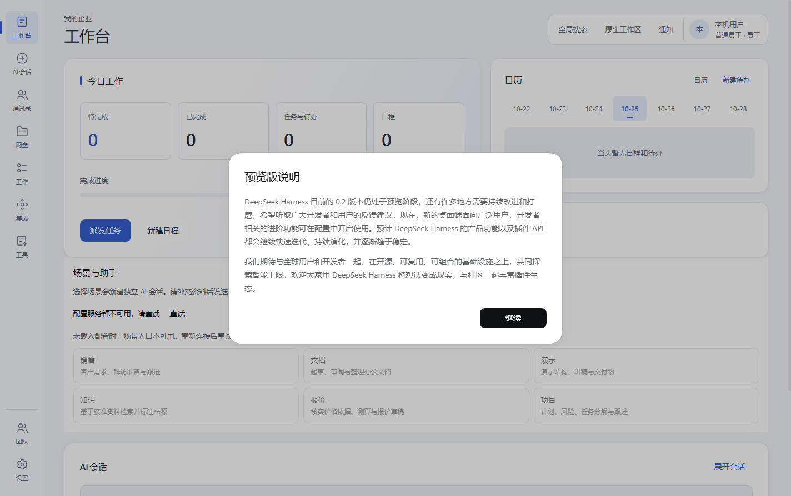

# 企业办公 Agent 工程归拢与 Windows 开发安装版

本次交付范围是保存工程资料、集中默认GUI开发入口、生成Windows安装程序及推送源码。原六个Native任务没有因此整体验收，实时总数保持175项：137完成、35进行中、3未开始。原工作区、活动数据和未提交改动保留。

## 保存结果

| 内容 | 实际结果 |
| --- | --- |
| 初始源码、原型、文档与交接文件 | 19,362文件、286,856,978字节，复制时逐文件核对SHA-256 |
| 运行脚本与记录 | 24,944文件逐一校验，保存在私密`runtime-records`目录 |
| 三个来源仓库历史 | `deepseek-harness`、`dsh-desktop`、`cc-switch`的bundle各首次验证通过，同时保留staged/unstaged补丁 |
| 原型数据、原始会话和交接日志 | 保存在`local-only`，禁止提交和打入安装包 |
| 旧归档失败 | 三次结果原样保留；选定脚本另按文件保存，不将失败tar标为成功 |
| 公开资料检查 | 扫描14,724个文本文件；候选为测试用假值、示例代理地址、包名或文案，未发现待发布的真实私钥或供应商token |
| 最终交接核对 | Agent08冻结交接的131个文件首次SHA匹配；23项Git文件模式同时保留 |

源码迁入后，工作区架构与MySQL设计文档集中到`development/企业工作台页面开发文档/`，原始会话移入私密归档。安装输入不包含真实员工凭据、现有数据库、浏览器存储或Git历史包。

68个未跟踪的TypeScript派生js/map文件移入私密`source-emissions`归档，SHA保留；对应ts/tsx继续作为维护输入。原仓库及Session快照未改。迁入源码的message-provider仅整理多余末尾空行，原字节另存私密副本；Cosmokit固定版本README保留原字节，按第三方输入明确豁免其原有空白。

## 实际验证与轮数

| 检查 | 结果与限制 |
| --- | --- |
| Node与包管理器 | 后台/工具Node24.22.0、pnpm11.28.5；Electron43内置Node24.17.0，分别记录 |
| 原生Electron目标 | `verify-target.mjs win32 x64`首次通过，指纹未变不重复 |
| 根仓库TypeScript | `npm run typecheck`首次通过；其范围不包括Harness全部Client及新的mjs脚本 |
| 根仓库完整测试r1 | 181文件、1,636用例：1,599通过、30失败、7跳过；不是全绿 |
| 修复后定向r2 | 仅选择上述失败中的9个Python环境用例与1个默认启动契约用例，10通过；另外7个已绿用例不重跑 |
| 依赖布局 | 9,064个目录junction首次完整创建；文件symlink的EPERM问题没有因此修复 |
| 启动前产物备份 | 实际归档358个产物目录、205,855,232字节，记录SHA-256，不伪造完整release标记 |
| 源码目录GUI检查 | r1未暴露窗口检查端点；r2检查调用超时；r3服务已running但窗口仍在启动页。三次记录保留，不运行第四次同场景 |
| EXE实际安装 | 首版安装r1通过；修正版覆盖安装r2通过。安装后的Node24.22.0、pnpm11.28.5和ASAR均验证；既有测试Profile备份摘要保持不变 |
| 安装后GUI | r1遇到Chromium拒绝6000端口；修复端口范围后r2通过，工作台/AI会话/通讯录实际挂载，端口56327，退出码0、controller为stopped，共约22秒。不再重跑已绿场景 |

GUI入口已经修复ESM初始化等待及PowerShell退出后继承管道导致的等待问题。Windows资源复制首次失败于267字符目标路径，改由系统robocopy处理长路径，并逐文件核对类型和大小。安装后流程单独记录，不用源码目录的结果代替实际安装验收。

最后安装输入含142,379个资源文件、3,573,570,802字节。修正版入口与当前维护源码SHA完全相同，实际安装界面如下；首次预览说明保持原样。场景配置服务不可用仍是未解决项，没有修改截图、跳过旧失败或声称全部业务功能已验收。

定向Python验证使用准备好的Office Python3.12.14，在生成目录建立`python3.exe`普通副本并将该目录置于PATH；没有修改文件symlink权限，也不将环境修正计为T137完成。

## 仍未解决的检查

完整测试r1余下20个失败分布在11个文件：generation-installer(1)、harness-node-entry(2)、host-disabled-plugins(3)、image-generation(6)、lan-mobile-bridge(1)、legacy-preset-migration(1)、market-baseline(1)、office-runtime(2)、plugin-startup-failure(1)、ppt-personal-templates(1)、safe-mode-runtime(1)。原始日志留在`.build/enterprise-tests-r1.log`，按实际失败保留；没有重复运行其余1,599个通过项。

Harness严格Client watcher仍有诊断，最近原仓库交接值为186；新启动日志保留实际诊断，不声明完整类型、完整Host或生产版本通过。旧Host第三次构建、旧Electron/下载、终端、Steering和子Agent等封顶场景没有重跑。默认GUI使用已有built CLI并监听Client源码，Host源码修改仍需单独构建和重启。

## 交付记录

当前安装程序为`dist-enterprise/EnterpriseOfficeAgent-Dev-20261025-r2-x64-Setup.exe`，960,348,291字节，SHA-256为`f8223b8fbd4727214950f4ee852a26893ff7b8828826a33f50f667bb88a2f362`。首个失败端口版本保存在`dist-enterprise/history/r1-unsafe-port/`，不覆盖原包。

安装程序生成、实际检查和摘要见`consolidation-status.json`；远程写入回执保存在其指定的私密receipt，避免在版本化文件内记录自身提交ID。开发安装包未使用签名证书。源码、私密资料和生成产物分开保存；仅Git源码的全新checkout不等于已取得当前开发运行快照。

打包总计调用5次：前2次因依赖隔离和已知启动修正主动中止，第3次出现长路径复制错误，第4次生成首版，第5次生成端口修正版。按故障分别继承计次；原Host/Electron等封顶场景没有重开。原失败、两份EXE、源码GUI三次失败和安装GUI两次结果均保留。

证据在`.build/enterprise-checks/`、`.build/enterprise-*.log`与`local-only`。原始报告和失败快照不覆盖；新增修正保存在独立记录中。
